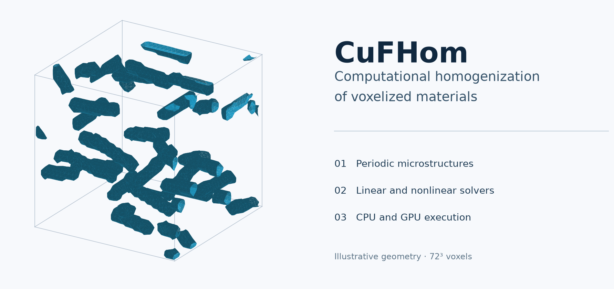

<h1 align="center">
  <a href="docs/assets/cufhom-logo-light.svg#gh-light-mode-only">
    
  </a>
  <a href="docs/assets/cufhom-logo-dark.svg#gh-dark-mode-only">
    
  </a>
</h1>

<p align="center"><strong>Periodic homogenization with specialized GPU solvers.</strong></p>

[](https://github.com/kevinvidalalmeida-bit/CuFHom/actions/workflows/ci.yml)
[](LICENSE)

**CUDA Fourier Homogenization (CuFHom)** computes the effective stiffness of
voxelized heterogeneous solids by solving six periodic equilibrium problems.
A common material interface supports
Fourier–Galerkin with numerical integration (**GaNi**) and fully integrated
trilinear hexahedral finite elements (**HEX8**). Their CUDA implementations reduce
intermediate data movement through different spectral and nodal execution plans.
Small problems also run on CPU without CUDA.
The workflow supports repeated effective-stiffness evaluations, including
material-parameter sweeps and microstructure screening.

[Quick start](#quick-start) · [Usage and API](docs/USAGE.md) ·
[Reproduce benchmarks](benchmarks/reproduce/README.md) ·
[Numerical conventions](docs/NUMERICS.md) · [Testing](docs/TESTING.md)



*Illustrative CPU-generated geometry. Surface smoothing is for visualization
only. [Recreate this image](examples/plot_geometry_example.py) with the optional
`plots` dependencies.*

## What the implementation contributes

The contribution is the execution of these established formulations within one
six-load workflow, with route-specific GPU kernels and explicit acceptance checks.

| Component | Implementation |
| --- | --- |
| GaNi | Fused compatible spectral transforms, constitutive actions and Krylov operations. See [coordinates](src/fft/linear/coordinates.py) and [generated FFTs](src/fft/linear/fused.py). |
| HEX8 | Matrix-free nodal stencils and fused FFT reference preconditioning. See [nodal operator](src/fft/linear/hex8_general.py) and [CUDA kernels](src/fft/linear/hex8_fused.py). |
| Precision and acceptance | FP64 and mixed-precision preconditioned conjugate gradients (PCG), fresh equilibrium checks and explicit failures. See the [shared entry point](src/fft/linear/framework.py). |
| Effective tensor and storage | Residual-corrected assembly from the six solutions and adaptive GPU/host residency. See [numerical conventions](docs/NUMERICS.md). |

The [component controls](benchmarks/reproduce/README.md#component-controls)
test selected implementation choices using paired runs. CPU examples establish
usability and numerical checks; they do not measure the specialized CUDA kernels.

## Quick start

Install from this source repository; no CUDA installation is needed for the CPU
example. Python 3.11 or later is required.

```bash
git clone https://github.com/kevinvidalalmeida-bit/CuFHom.git
cd CuFHom
git checkout v0.1.1
python3 -m venv .venv
source .venv/bin/activate
python -m pip install .
python examples/linear_elasticity.py
```

The example builds a small two-phase cell, solves all six loads with both routes
in FP64 and prints the effective tensor, update counts and maximum fresh relative
residual for each route. It checks all six acceptance decisions. It is an
installation example, not a performance comparison.

For your own image, supply integer phase labels and a table of stiffness matrices:

```python
from cufhom.fft import IndexedMaterial, homogenize

# labels: integer array (nx, ny, nz)
# table: one row per material, with 21 packed upper-triangular Mandel entries
material = IndexedMaterial(labels, table, dtype="float64")
result = homogenize(
    material, discretization="hex8", backend="numpy",
    working="float64", rtol=1e-6,
)
stiffness = result["C"]        # 6 x 6 effective stiffness
audits = result["audits"]     # six fresh equilibrium checks
```

Mandel order is `(11, 22, 33, 23, 13, 12)` with √2 shear scaling. Stiffness has
the same stress units as the material inputs. The [usage guide](docs/USAGE.md)
shows how to construct the table and select GPU precision; `help(homogenize)`
describes the API options.

### GPU execution

Install the CuPy distribution matching your CUDA environment separately. The
same API uses `backend="cupy"`; an FP64 material with `working="float32"`
selects mixed precision with FP64 solution accumulation. Set
`working="float64"` explicitly for FP64 iteration.

```bash
CUFHOM_FUSED_COMPILE=sync python benchmarks/reproduce/run.py \
  --protocol benchmarks/reproduce/protocols/public.json --output results/public
python benchmarks/reproduce/summarize.py results/public
```

The protocol runs independent processes and saves input/source hashes, hardware,
six update counts, fresh residuals, tensors, timing boundaries and failures.
GPU tests require explicit opt-in: `python -m pytest --gpu -m gpu`.
Optional [CUDA environment setup](tools/env_gpu.sh) is available for NVIDIA
libraries installed as Python wheels.

## Reproducible numerical studies

[Fixed inputs and executable protocols](benchmarks/reproduce/README.md) cover
six synthetic microstructures and a separately licensed public image: discrete
reference comparisons, tolerance sweeps, direct/corrected assembly, contrast,
reference-operator sensitivity, grid scaling and component ablations.
[`section41.py`](benchmarks/reproduce/README.md#six-cell-comparison-section-41)
runs the complete six-cell comparison against FANS and FFTHomPy, resumably.

Start with a small CPU run, then use the documented GPU protocols. Optional
external adapters pin **FANS from UNO-CG (PyTorch/GPU)** and **FFTHomPy (CPU)**
to specific source revisions. FANS here is distinct from the standalone C++ FANS
program. The [benchmark guide](benchmarks/reproduce/README.md) states timer
inclusions, native norms, material rounding and output definitions.

These protocols generate new measurements. They do not distribute the manuscript
or archived performance results, and cannot guarantee historical wall times.
The quick start pins [version 0.1.1](CHANGELOG.md). For a reproducible study,
record `git rev-parse HEAD` and retain the generated
protocol, environment records and all accepted and failed points.

## Scope

The linear workflow assumes periodicity, a uniform Cartesian grid, small strains,
perfectly bonded interfaces and positive-definite constituent stiffnesses.
GaNi and HEX8 use different discrete operators and native residual norms; a
shared tolerance does not establish equal continuum error. High contrast,
rounding and available device/host memory can limit attainable accuracy or size.

Additional fiber-geometry generators and incremental nonlinear material models
remain available through the [usage guide](docs/USAGE.md). The linear benchmark
protocols do not validate their nonlinear performance. External data retain their
own [license and attribution](benchmarks/reproduce/inputs/README.md).

## Development and citation

```bash
python -m pip install -e '.[dev]'
python -m ruff check src core tests examples benchmarks
python -m ruff format --check src tests examples benchmarks
python -m pytest -m 'not gpu and not slow'
python -m build
```

CI checks CPU behavior on Python 3.11–3.13, builds both distributions and tests
the installed wheel outside the source checkout. Own-code docstrings follow
PEP 257; the incorporated core retains its upstream notices and formatting.
See [testing](docs/TESTING.md) and [contributing](CONTRIBUTING.md) for details.

Code is under the [MIT license](LICENSE). The incorporated FFTHomPy core retains
its [original attribution](third_party/ffthompy/README.md). Cite the software
using [CITATION.cff](CITATION.cff), including the revision used in your study;
cite upstream solvers and datasets when using their comparisons or inputs.

Transparent vector logos and standalone icons are in [docs/assets/](docs/assets/).
Use the `light` variants on light backgrounds and the `dark` variants on dark
backgrounds; the README selects the version for GitHub's active theme.
