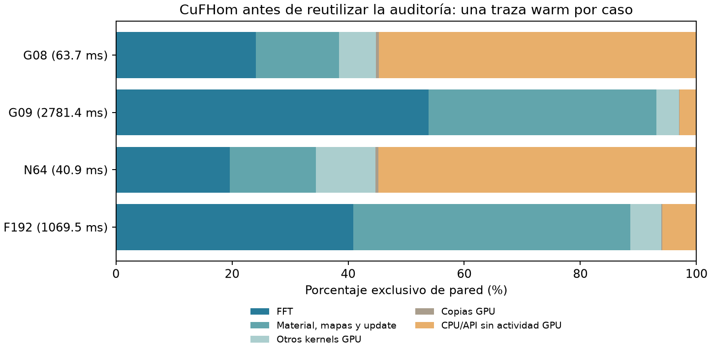

# CuFHom: identidad de referencia y reutilización de la auditoría

**Se integra la reutilización final; la identidad queda como piloto retirado.** La identidad ahorra 1–4% en varias mallas grandes, sin cambiar sus iteraciones, pero pierde precisión para fases muy blandas. Reutilizar deformación y tensión evita trabajo repetido y conserva la ecuación y su auditoría física.

## Identidad probada en GPU

`H = I + Q_R* (C-C₀) Q_R` sobre las coordenadas admisibles. La norma directa se fusiona con el mapa; el material de referencia escribe contraste cero. Seis cargas, FP32 en campos/FFT, sumas FP64 y residual físico 1e-5. RTX 5070 Ti; cinco repeticiones rotadas tras calentamiento. El tiempo incluye setup de material, solve, auditorías, posprocesado y JSON; las entradas se cargan/compilan antes de medir. Se mantienen las optimizaciones A/B previas.

| Caso | Actual s | Split directo s | Ahorro % | CG, ambos | Ahorro pareado min–max % |
| --- | ---: | ---: | ---: | ---: | ---: |
| G08 | 0.051983 | 0.052741 | -1.46 | 256 | -1.71–3.46 |
| G09 | 2.769698 | 2.740580 | 1.05 | 276 | 0.97–1.22 |
| F192 | 1.065520 | 1.029755 | 3.36 | 264 | 2.77–3.50 |
| N64 | 0.036549 | 0.035998 | 1.51 | 148 | -6.00–3.74 |
| N256 | 1.833470 | 1.767427 | 3.60 | 132 | 3.41–3.68 |
| R128 | 0.205879 | 0.200128 | 2.79 | 162 | 2.18–3.80 |

F192: fibras Vf 15%, AR 10, orientación aleatoria. N64/N256: inclusiones compactas; R128: regiones con dos orientaciones. El método no usa etiquetas de fibras. G08 empeora ligeramente; N64 tiene variación que impide afirmar una ganancia. Los intervalos son extremos de cinco pares, no intervalos de confianza.

La variante recurrente de `||p||²` tampoco supera a la directa en las cuatro mallas grandes; sus tiempos quedan en [split.csv](split.csv). La igualdad de H conserva espectro y condición: **no reduce CG ni FFT**.

## Límite numérico encontrado

| C = η C₀ | Error relativo de p*Hp, original | Error relativo, split |
| ---: | ---: | ---: |
| 1e+00 | 6.07e-08 | 8.88e-16 |
| 1e-01 | 4.41e-08 | 6.39e-07 |
| 1e-02 | 4.61e-08 | 7.46e-06 |
| 1e-03 | 2.5e-08 | 6.03e-05 |
| 1e-04 | 7.15e-08 | 0.000524 |
| 1e-05 | 5.19e-08 | 0.00745 |
| 1e-06 | 3.91e-08 | 0.0744 |

En una fase 1e6 veces más blanda, el split pierde 7,44% por cancelación. Los productos FP64 no reparan el redondeo previo de `C-C₀` y ε en FP32. No equivale a 7,44% de error medido de Ceff: este cribado mide el denominador de una dirección. La ruta original conserva su precisión. Por eso no se activa el split como opción general predeterminada. [Código aislado y decisión](../../descartados/reference_split_20261002/README.md).

## Reutilización final integrada

`linear_final_audit_reuse=True` retiene deformación/tensión exclusivamente en las comprobaciones verdaderas de CG. Reutiliza solo el mismo iterado sin un campo inicial añadido. La proyección exige los mismos factores material/GN del operador físico; las otras rutas evalúan el operador completo. Una corrección posterior vuelve a auditar. La escala, la proyección, el umbral y los productos FP64 permanecen. Se elimina una IFFT de seis componentes y un producto de material por carga reutilizada; no se conserva el espectro de tensión.

| Caso | Reutilización desactivada s | Activada s | Ahorro % | CG, ambos |
| --- | ---: | ---: | ---: | ---: |
| G08 | 0.055843 | 0.054938 | 1.62 | 256 |
| G09 | 2.770770 | 2.746465 | 0.88 | 276 |
| F192 | 1.067835 | 1.055704 | 1.14 | 264 |
| N64 | 0.037145 | 0.037400 | -0.69 | 148 |
| N256 | 1.832422 | 1.799574 | 1.79 | 132 |
| R128 | 0.206738 | 0.203485 | 1.57 | 162 |

Son cinco pares alternados con el mismo código final y entradas, comparando solo la opción de reutilización. Los ahorros de ambas tablas no se suman: son campañas distintas y la identidad sigue retirada. En 64³ la diferencia queda dentro de la variación. G09, F192 y N256 mejoran en los cinco pares; R128 mejora en cuatro de cinco. [reuse.csv](reuse.csv).

## Validación

**345 pruebas y 7 subpruebas de producción; 13 controles independientes del split.** Los siete controles nuevos de reutilización verifican formas pares/impares, fusiones activadas/desactivadas, campos completos, campo inicial con material cambiado, iterado distinto y operador físico incompatible. La falsa convergencia todavía provoca corrección y auditoría.

El split se compara en seis campos completos de los seis casos de la tabla, además de 8³ contra CPU64 a 1e-10. El tensor CUDA se compara también contra el operador CPU64 con tensores SPD anisótropos y contrastes negativos. Todos los solves aceptados tienen Ceff SPD y residual físico ≤1e-5.

- G08, reutilización: diferencia L2 máxima de campo 2.14e-09; Ceff relativa 6.82e-13; campos bit a bit: no.
- G09, reutilización: diferencia L2 máxima de campo 0; Ceff relativa 0; campos bit a bit: sí.
- F192, reutilización: diferencia L2 máxima de campo 0; Ceff relativa 0; campos bit a bit: sí.
- N64, reutilización: diferencia L2 máxima de campo 1.11e-09; Ceff relativa 5.09e-13; campos bit a bit: no.
- N256, reutilización: diferencia L2 máxima de campo 0; Ceff relativa 0; campos bit a bit: sí.
- R128, reutilización: diferencia L2 máxima de campo 0; Ceff relativa 0; campos bit a bit: sí.

G08/N64 incluyen una segunda ejecución con reutilización desactivada para mostrar la variación del cleanup con reducciones atómicas. Los valores y banderas exactos se conservan en [fields.csv](fields.csv); no se afirma igualdad bit a bit cuando esos controles difieren.

## Dónde atacar después, según el código y la traza

La traza siguiente corresponde al código A/B previo a esta reutilización (`97939c6252ac`), una ejecución warm instrumentada por caso. No se usa como muestra estadística de velocidad. Las categorías exclusivas no se solapan; los tiempos inclusivos de API pueden esperar a GPU y no son tiempo de transferencia.



| Caso | Pared ms | FFT % | Material/mapas/update % | Host en CG sin GPU % | D2H dentro de CG |
| --- | ---: | ---: | ---: | ---: | ---: |
| G08 | 63.74 | 24.09 | 14.36 | 22.86 | 508 |
| G09 | 2781.44 | 53.85 | 39.28 | 1.15 | 564 |
| N64 | 40.85 | 19.60 | 14.84 | 18.20 | 298 |
| F192 | 1069.47 | 40.92 | 47.70 | 2.26 | 540 |

En G09 esas tres familias de kernels ocupan 93,13% de pared; incluyen RHS/auditorías además de H. El posprocesado ocupa ≈1,3% del total. En G08 hay 508 lecturas D2H dentro de CG, pero solo 4.676 bytes D2H en toda la traza: predomina la frecuencia de sincronización, no el volumen de transferencia. `float(cp.sum(...))` aparece dos veces por iteración en energía y update. Las opciones lazy/check-every del CG antiguo no eliminan esas lecturas en `fused_cg` de coordenadas.

La siguiente prioridad para mallas pequeñas es mantener alpha, beta y normas FP64 en GPU, comprobando estado por grupos sin cambiar el residual verdadero. Para grandes, probar conservar el espectro final y eliminar buffers/tráfico dentro de H; las sincronizaciones ofrecen mucho menos margen. Estas extensiones no se implementaron en esta campaña.

## Qué enseñó el cribado matemático adicional

Se probó la compliance fina proyectada, distinta del Q1/GenEO retirado. Invertir C y proyectar no equivale a invertir el operador restringido. La condición baja en los cinco problemas CPU64 5³, pero las iteraciones suben en tres y la aplicación añade otra pareja de FFT. El coste aproximado con H/B iguales queda entre 1,42 y 2,36 veces la base; es un cribado, no un tiempo GPU. [Derivación](DERIVATION.md).

Un laminado tiene κ≈30 y solo siete CG para las seis cargas; una inclusión compacta con κ≈30 requiere 107 en la misma malla de 372 grados reales. El espectro completo, su agrupamiento y los pesos del RHS explican por qué tamaño/κ por sí solos no predicen iteraciones. La memoria aumenta el coste de cada H en una malla grande; no explica por sí misma más CG.

Ceff por tensiones medias se comprobó solo en esos problemas CPU64: difiere hasta 2,5e-9 de la matriz de energía a rtol 1e-8. Sigue pendiente una validación GPU al umbral físico real antes de sustituir el posprocesado.

## Evidencia y reproducción

[evidence.json.gz](evidence.json.gz) conserva JSON crudos, logs de pruebas, trazas resumidas y las versiones exactas del código por SHA256. Las mediciones split/trazas preceden el cambio de producción; las de reutilización coinciden con sus hashes finales. [manifest.json](manifest.json) verifica archivos. Entradas grandes, SQL y `.nsys-rep` permanecen en `benchmarks/results/code_review_20261002/`, fuera de Git.

```bash
.venv/bin/python benchmarks/code_review_20261002/build_report.py \
  --evidence benchmarks/code_review_20261002/evidence.json.gz \
  --output /tmp/cufhom_code_review
```

Reconstruir el informe no requiere GPU ni sudo. Para repetir los tiempos GPU, cargar `benchmarks/reference_solvers/env_gpu.sh` y ejecutar `run_split.py` o `run_reuse.py` con `--case`, `--repeats 5` y un directorio de salida nuevo. Los hashes históricos permiten evaluar la procedencia; medir con código futuro puede producir otros resultados.
