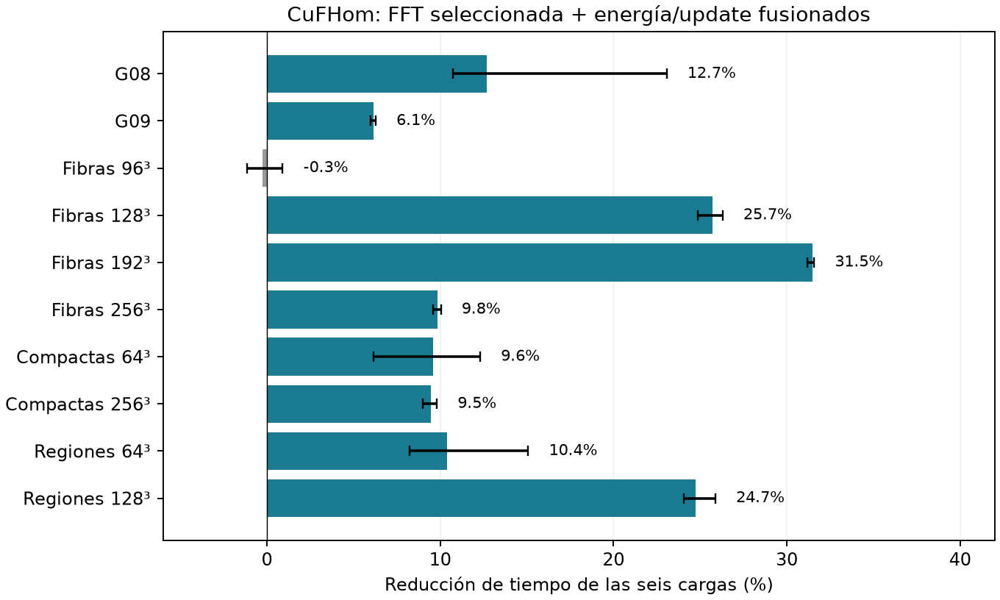

# CuFHom: estrategias lineales implementadas y medidas

**Se integran FFT y energía/update por defecto en la ruta compatible.** En G09: 2.963 → 2.781 s (6.14%); en fibras 192³: 1.557 → 1.067 s (31.46%).
Se implementaron también el auxiliar Q1, GenEO y su Galerkin fino real. No mejoran el tiempo y quedan en `descartados`, con derivación y código reproducible.

## Seis cargas: configuración final

RTX 5070 Ti. Cinco repeticiones alternadas tras calentamiento; medianas de pared. Incluye material, solve, auditorías físicas, posprocesado y JSON. Carga/compilación de geometría se mide aparte. La referencia desactiva solo las dos opciones nuevas; mantiene las fusiones y el suavizado previamente aceptados. Campos/FFT FP32, productos de Krylov FP64, mismo residual físico 1e-5 y máximo 1000 iteraciones.

| Caso | Previa s | Predeterminados s | Ahorro % | FFT elegida | CG antes/después |
| --- | ---: | ---: | ---: | --- | ---: |
| G08 | 0.061114 | 0.053364 | 12.68 | full | 256/256 |
| G09 | 2.962991 | 2.781189 | 6.14 | component | 276/276 |
| F96 | 0.151010 | 0.151416 | -0.27 | full | 278/278 |
| F128 | 0.417915 | 0.310538 | 25.69 | batch2 | 264/264 |
| F192 | 1.557344 | 1.067395 | 31.46 | component | 264/264 |
| F256 | 3.845175 | 3.467201 | 9.83 | component | 272/272 |
| N64 | 0.040957 | 0.037023 | 9.61 | full | 148/148 |
| N256 | 2.039642 | 1.846265 | 9.48 | component | 132/132 |
| R64 | 0.042524 | 0.038105 | 10.39 | full | 163/163 |
| R128 | 0.275616 | 0.207494 | 24.72 | batch2 | 162/162 |

F = Vf 15%, AR 10, orientación aleatoria y dominio 2L; N = inclusiones compactas generales; R = regiones oblicuas con dos orientaciones. G08/G09 conservan sus entradas originales. La ganancia de estas rutas viene del coste por aplicación; no disminuyen las iteraciones. 96³ conserva lote completo y su diferencia de tiempo queda dentro de la variación de esta campaña.



Las barras muestran el cociente de medianas; las líneas, el mínimo/máximo de los cinco ahorros pareados. No son intervalos de confianza ni una cota universal.

G09 y F192 se repitieron con hashes idénticos al código final. Las otras ocho mediciones preceden la corrección del contador de material en `profile_timing`: solo difiere `applications.py`; los kernels y las rutas no instrumentadas medidas conservan sus operaciones. Los hashes originales y esa diferencia se registran por caso en `summary.json`.

## Selección inicial y amortización

El tuner prueba lotes de 1, 2, 3 y 6 componentes con H completo; valida su salida, mide cinco rondas rotadas y guarda la elección. Una política explícita tiene prioridad. La caché incluye forma, dtype, GPU y versiones de CUDA/cuFFT/CuPy. Cada primer uso cobra el tiempo siguiente; las siguientes cargas/ejecuciones reutilizan la decisión. No se afirma que cinco muestras de H certifiquen el plan óptimo de todo solve.

| Caso | Selección inicial ms | Solves para amortizar selección, estimación |
| --- | ---: | ---: |
| G08 | 22.64 | 3 |
| G09 | 226.20 | 2 |
| F96 | 26.56 | Sin ahorro medible |
| F128 | 39.08 | 1 |
| F192 | 123.33 | 1 |
| F256 | 275.23 | 1 |
| N64 | 22.99 | 6 |
| N256 | 271.19 | 2 |
| R64 | 23.02 | 6 |
| R128 | 39.80 | 1 |

La estimación divide el coste de selección por la diferencia entre medianas warm de los predeterminados y su referencia. Excluye creación del contexto/JIT: no sustituye una campaña independiente de arranque completamente frío. Los warmups completos y sus tiempos siguen disponibles en el bundle.

## Fusión de energía y memoria

`Re(p*Hp) = <QRp, CQRp>` mueve la suma FP64 al kernel de material. Después del R2C se aplican adjunto y actualización de x/r en el mismo kernel. Se elimina el vector Hp y se libera el espectro consumido antes del siguiente H. En G09 se evitan 334,54 MB de escritura/lectura **lógica** por iteración; no se presentan como bytes DRAM medidos.

El diagnóstico de asignaciones warm registra 4.287 → 4.128 GiB de máximo activo en el pool CuPy. Excluye escritorio, contexto y asignaciones fuera del pool. Cuenta 276 H de iteraciones y 6 H de comprobación coordenada en ambas rutas; la auditoría Afun física y la preparación/RHS están fuera de ese conteo. No se usan sus tiempos instrumentados para calcular aceleración.
Los atributos compilados de material/adjunto/adjunto suavizado indican 40/32/40 registros y cero bytes locales. Es información del compilador, no una nueva campaña de contadores ni prueba de ausencia de spill en todo el programa.

## Auxiliar y GenEO: implementación y rechazo

Tres repeticiones alternadas por variante, con preparación una vez por material reutilizada en las seis cargas e incluida en el total. Cada fila usa su propia referencia contemporánea.

| G09 | Referencia s | Variante s | Preparación s, primera repetición | CG |
| --- | ---: | ---: | ---: | ---: |
| Auxiliar Q1 | 2.967 | 5.249 | 0.247 | 276 |
| GenEO auxiliar, τ=0,15 | 2.967 | 5.540 | 0.533 | 276 |
| GenEO fino, τ=0,15 | 2.963 | 7.685 | 2.722 | 276 |
| GenEO fino, τ=0,5 | 2.965 | 9.401 | 4.431 | 276 |

El umbral 0,5 selecciona 285 columnas, incluidas 123 deformables; rango de energía fino 282. Su preparación aplica H una vez por columna. Ampliar la base y usar la energía fina no reduce las 276 iteraciones. El auxiliar promedia coeficientes: puede perder contraste y modos útiles. Estas pruebas rechazan las variantes ensayadas, sin descartar todas las posibles construcciones GenEO.

La comprobación independiente CPU64 construye el espectro fino completo de 5³ impar (372 grados reales sin traslaciones), con inclusiones y laminado. El auxiliar Q1 empeora κ de ≈30 a ≈105–121; GenEO con energía fina queda en ≈31 y tampoco mejora los CG de esos RHS. Son condiciones de esos problemas pequeños, no estimaciones de κ de G09.

[Derivación propia](DERIVATION.md): adjunto de transferencia, normalización, V-cycle SPD, cociente local GenEO, Galerkin fino y suavizado PCG en la métrica B. [Código retirado](../../descartados/auxiliary_geneo_20261002/README.md).

## Validación y reproducción

**338 pruebas y 7 subpruebas de producción; 4 controles del prototipo auxiliar.** Se comparan los seis campos completos en G08/G09, compactas 64³, fibras 96³/192³ y dos casos 8³ contra CPU64. Todas las rutas mantienen residual físico ≤1e-5 y Ceff SPD. CPU64 comprueba 8³; no se afirma haber resuelto G09 completo en CPU64.

Máximo error relativo de Ceff en esas validaciones: 4.46e-08; máxima diferencia L2 de campos: 9.35e-05. Se conservan los valores por carga, incluida la comparación CPU64 y la variación debida al mismo umbral de parada.

[summary.json](summary.json) y [timings.csv](timings.csv) conservan cifras sin redondear; [evidence.json.gz](evidence.json.gz) contiene JSON de solves, cachés, validación, diagnóstico de memoria, logs de pruebas y una copia del código. [manifest.json](manifest.json) verifica hashes y procedencia. Las geometrías y los campos volumétricos grandes siguen fuera de Git.

Recrear tablas e imagen sin ejecutar CUDA ni usar sudo:

```bash
.venv/bin/python benchmarks/linear_strategy_20261002/build_report.py \
  --evidence benchmarks/linear_strategy_20261002/evidence.json.gz \
  --output /tmp/cufhom_strategy_report
```

Repetir una comparación GPU con un directorio nuevo:

```bash
source benchmarks/reference_solvers/env_gpu.sh
OPENBLAS_NUM_THREADS=1 .venv/bin/python benchmarks/linear_strategy_20261002/run_strategy.py \
  --case G09 --route combined --repeats 5 --output benchmarks/results/new_strategy_G09
```

Rutas del runner: `fft`, `energy`, `combined`, `auxiliary`, `fine_geneo`; `--geneo-threshold 0.5` amplía la selección. La formulación fina, las frecuencias y la tolerancia se conservan. Las decisiones se basan en forma/operador/coste, sin detección de fibras ni reglas por nombre de geometría.
