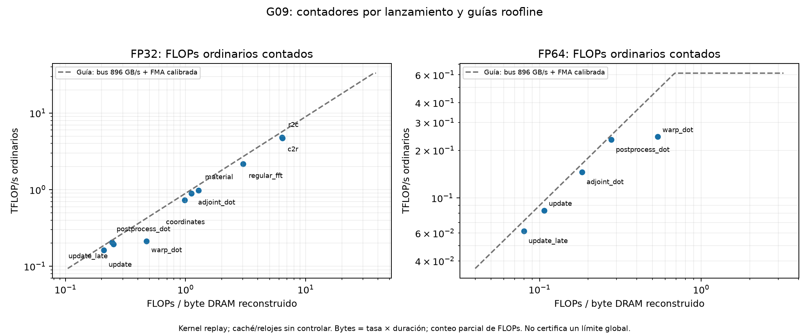

# Contadores GPU de CuFHom

Fecha: 1 de octubre de 2026. **60 capturas y 60 exportaciones completas**, obtenidas con una ejecución
administrativa puntual, sin reiniciar ni cambiar la configuración del controlador. El acceso normal sigue
sujeto a `RmProfilingAdminOnly: 1`. Se corrigió la exportación: esta versión usa `--print-units base`.
El archivo `.ncu-rep` anterior se conservó y se exportó sin repetir esa captura.

## Resultado

En G09 los mapas, Cε y updates alcanzan **747–798 GB/s**, con ocupación observada de **81–99%**.
Su estado predominante es `long_scoreboard`: esperan dependencias de operaciones de memoria.
Esta evidencia respalda priorizar reducir tráfico y aplicaciones de H. Aumentar ocupación por sí solo
ofrece poco margen en esos kernels. Los FFT muestreados alcanzan **719–757 GB/s**.
Las reducciones `warp_dot` alcanzan **84–88% del pico de la tubería FP64**; el dot final también
alcanza 841 GB/s. Tienen costes mixtos de memoria, instrucciones y reducción.

| Kernel G09 | GB/s DRAM | Ocupación % | L2 hit % | FP64 pico % | Estado predominante / % muestras |
| --- | --- | --- | --- | --- | --- |
| regular_fft | 719.4 | 87.3 | 64.4 | 0.0 | mio_throttle / 33.5 |
| r2c | 731.8 | 94.5 | 15.3 | 0.0 | long_scoreboard / 37.2 |
| c2r | 757.2 | 95.5 | 16.1 | 0.0 | long_scoreboard / 42.5 |
| material | 763.9 | 84.3 | 2.9 | 0.0 | long_scoreboard / 79.0 |
| coordinates | 747.0 | 80.7 | 22.7 | 4.7 | long_scoreboard / 72.2 |
| adjoint_dot | 797.8 | 95.9 | 3.4 | 62.3 | long_scoreboard / 56.0 |
| update | 781.6 | 98.9 | 33.3 | 21.0 | long_scoreboard / 84.5 |
| update_late | 773.9 | 98.7 | 37.5 | 15.6 | long_scoreboard / 84.5 |
| warp_dot | 451.4 | 95.3 | 0.2 | 88.0 | tex_throttle / 49.0 |
| postprocess_dot | 841.1 | 99.4 | 0.1 | 84.5 | long_scoreboard / 56.7 |

Son porcentajes de los recursos indicados y estados de warps muestreados. El porcentaje de un estado
**no es el porcentaje de pared recuperable**. No se debe sumar con los tiempos de Nsight Systems.
Los 60 lanzamientos reportan cero instrucciones de spill de registros; eso describe los lanzamientos
muestreados y no certifica todos los kernels del programa.

## FFT por componentes, 192³

| Familia | Auto: llamadas / media CUPTI µs | Component: llamadas / media CUPTI µs | Auto: MB reconstruidos/lanzamiento | Component: MB reconstruidos/lanzamiento |
| --- | --- | --- | --- | --- |
| regular_fft | 1152 / 467.81 | 6912 / 41.37 | 331.8 | 39.5 |
| r2c | 288 / 450.26 | 1728 / 77.36 | 326.5 | 44.0 |
| c2r | 288 / 439.70 | 1728 / 31.27 | 328.0 | 43.3 |

El lanzamiento por componentes trabaja sobre una porción menor y hay más llamadas. Su duración
individual no representa el ahorro global. La evidencia comparable sigue siendo la campaña alternada:
**1,561 → 1,190 s, 23,77% de ahorro**, seis cargas y campos/Ceff idénticos.
La traza completa reduce el tiempo FFT exclusivo de **795,2 a 473,7 ms**. La ocupación del `regular_fft`
muestreado baja de 63,4% a 26,4% y aun así mejora el solve completo. Conviene elegir el plan por el
tiempo total medido. [Estadística y validación](experiment_statistics.csv).

## Alcance y calidad de la medición

- Una instancia warm por etiqueta y caso: G08, G09, caso general 64³/256³ y fibras 192³ con auto/component.
  Se conservaron las seis cargas y el criterio físico original. Todos los residuales son ≤1e-5 y Ceff es SPD.
- `kernel` replay, `cache-control none`, `clock-control none`, nueve secciones de Nsight Compute.
  El perfilador advierte que cachés y relojes sin controlar pueden producir inconsistencias. Los valores
  describen esta captura; el replay no conserva exactamente la caché de la ejecución completa.
- Los contadores DRAM/L2 son recursos compartidos con otras actividades del dispositivo. En kernels cortos
  la actividad del escritorio puede pesar mucho. Hay **15 muestras marcadas** por duración <20 µs
  o porcentajes fuera de rango. Por ejemplo G08 r2c reporta ocupación 106,96%; se conserva el valor original
  y se marca. No se transforma en una eficiencia física ni se recorta a 100%.
- `update_late` es una etiqueta de selección por índice, no una prueba de variante. Los registros muestran
  que en G08/64³ ambas muestras son el update normal (34 registros). En G09/256³/192³ sí se capturó
  suavizado (36 registros). El mapa muestreado tiene 38 registros; no se capturó el mapa fusionado de 40.

NVIDIA documenta el replay, la interferencia de otras actividades, los porcentajes fuera de rango y las
diferencias de duración entre herramientas en su
[guía de Nsight Compute](https://docs.nvidia.com/nsight-compute/ProfilingGuide/index.html).

## Roofline: datos medidos y datos derivados

`DRAM_GB_s` procede de `dram__bytes.sum.per_second`. No se recogió `dram__bytes.sum` directamente:
los bytes de esta tabla se **reconstruyen como tasa × duración**. Se identifican como derivados y pueden
mezclar variación entre pases y tráfico de otros motores. Los FLOPs ordinarios se calculan con las
instancias de instrucciones por hilo predicadas: FFMA/DFMA cuentan dos, FADD/DADD y FMUL/DMUL cuentan uno.
MUFU, shuffles, enteros y operaciones empaquetadas HFMA2 se guardan aparte y quedan fuera de esa suma.
Es un conteo parcial de trabajo aritmético, no un modelo completo de todas las tuberías.



La guía usa el bus teórico de 896 GB/s y la calibración FMA independiente. Cada panel cuenta solo
aritmética ordinaria de esa precisión; el kernel puede estar limitado por otras instrucciones o recursos.

[gpu_counters.csv](gpu_counters.csv) distingue métricas, bytes reconstruidos, instrucciones, stalls,
variante observada y banderas de calidad. [kernel_profile.csv](kernel_profile.csv) enlaza muestras con
el kernel de la traza; las columnas de contadores describen la primera muestra nombrada en cada fila,
no la media de todas sus llamadas. Los tiempos e hipótesis originales de esa tabla se conservaron.
`DRAM_bytes` y `warp_efficiency` permanecen vacíos porque no se midieron directamente.

Esta campaña resuelve el acceso a contadores y fortalece el diagnóstico. **No certifica un mínimo hardware
global**: faltan cobertura de todas las variantes, control de caché/reloj y repeticiones de contadores.
Los escenarios roofline anteriores siguen siendo condicionados. La ganancia de FFT por componentes
proviene de los tiempos alternados sin Nsight Compute.

## Siguientes cambios que justifica la evidencia

1. Evaluar una política general de planes FFT por forma, dtype, dispositivo y tiempo del solve; las cifras
   de 96³ impiden escoger component para todas las mallas.
2. Probar un precondicionador SPD que reduzca aplicaciones de H y cuyo ahorro supere setup/aplicación.
   La base adaptativa propuesta en el [informe principal](PERFORMANCE_AUDIT.md) sigue pendiente de validación.
3. Medir si una nueva fusión elimina lecturas/escrituras de campos grandes sin repetir fusiones existentes.
   Los kernels cerca del techo de memoria necesitan reducir bytes, no solo instrucciones de launch.
4. Revisar la reducción FP64 con el mismo criterio físico y precisión. Su tiempo exclusivo y Amdahl delimitan
   el beneficio posible; no se justifica cambiar precisión con estos contadores.

## Evidencia y reproducción

El bundle [counter_evidence.json.gz](counter_evidence.json.gz) conserva CSV crudos con unidades, logs,
instancias por opcode, informes de las seis cargas y hashes de `.ncu-rep`/entradas/código.
[counter_manifest.json](counter_manifest.json) resume procedencia y verificaciones.
Los 60 `.ncu-rep` permanecen en `benchmarks/results/ncu_counters_20261001_7saBZK/`.

Recrear las tablas desde el bundle no requiere sudo ni ejecutar el solver:

```bash
.venv/bin/python benchmarks/build_gpu_counters.py \
  --evidence benchmarks/performance_audit_20261001/counter_evidence.json.gz \
  --output benchmarks/performance_audit_20261001
```

Para una nueva captura, `sudo bash benchmarks/profile_gpu_counters.sh` solicita la contraseña en la terminal.
`--resume DIRECTORIO` conserva capturas previas; la exportación offline usa `--export-only` en el script Python.
