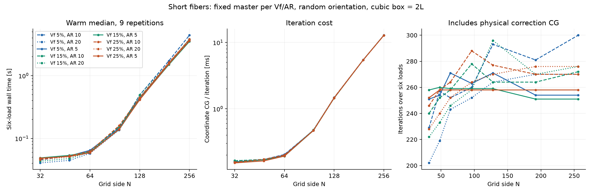
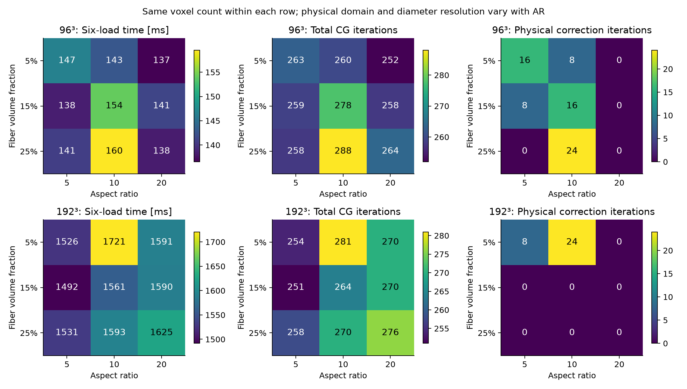
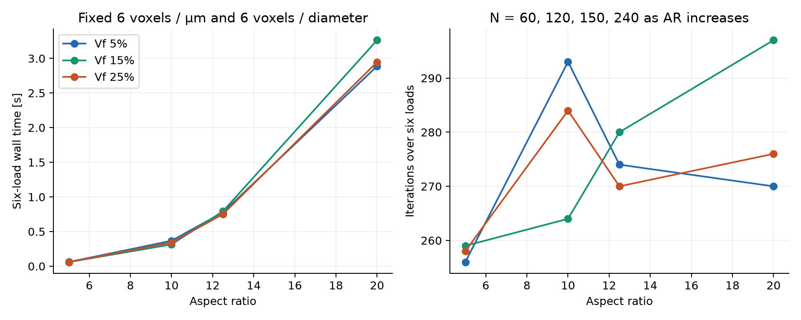
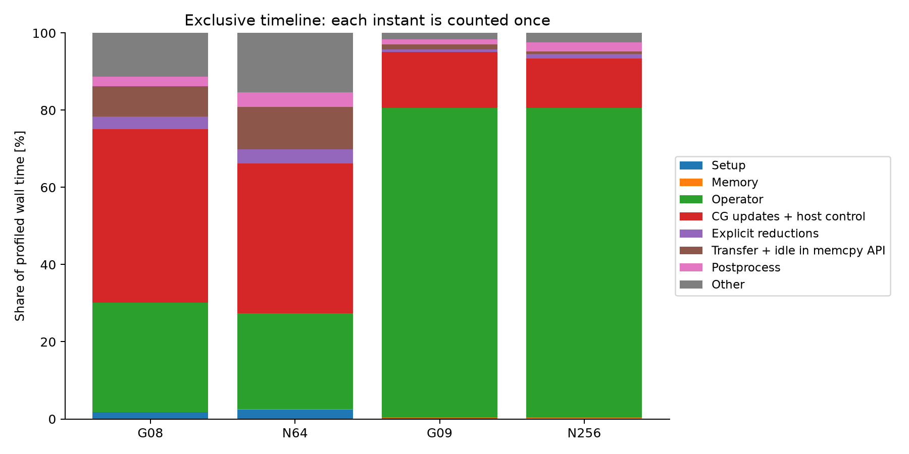
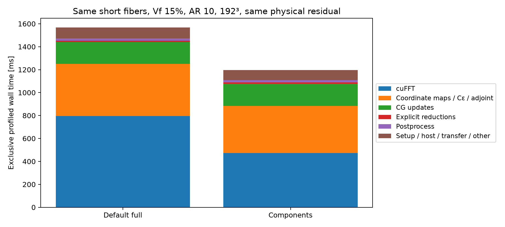

# Auditoría de rendimiento de CuFHom

Fecha: 1 de octubre de 2026. GPU: RTX 5070 Ti de 16 GB. Referencia de producción:
`92c9ac5b8204288244e82536b254078d6d767e66`. **El código de producción y sus opciones predeterminadas no se modificaron.**

## Diagnóstico principal

Hay margen de implementación demostrado: con la misma geometría de fibras, seis cargas, precisión y tolerancia,
elegir FFT por componentes reduce **192³ de 1,561 a 1,190 s**, aproximadamente **24%** o **1,31×**.
En 128³ ahorra alrededor del 22%; en 96³ empeora. El plan de cuFFT debe elegirse por dimensiones,
precisión y GPU; hacerlo depende del coste de las transformadas y funciona para materiales generales.

También hay un coste algorítmico concreto: algunas geometrías activan CG de corrección en deformaciones
después de terminar CG en coordenadas. En Vf=5%, AR=10, 256³ son **48 iteraciones y 827 ms adicionales**.
La aceptación con dos normas evita parte de ese trabajo a la tolerancia pública, pero **el control de precisión
comparable pierde la mejora**. Ese resultado descarta promoverla como aceleración general.

**No se ha demostrado un límite físico global.** Nsight Systems funciona, pero Nsight Compute devuelve
`ERR_NVGPUCTRPERM`; el controlador sigue mostrando `RmProfilingAdminOnly: 1`. Faltan bytes DRAM reales,
ocupación, hits de caché y stalls. Los modelos de roofline son escenarios condicionados y se identifican así.
La [documentación de NVIDIA](https://developer.nvidia.com/nvidia-development-tools-solutions-err_nvgpuctrperm-permission-issue-performance-counters)
describe esta restricción del controlador. Dar acceso a los archivos no cambia ese permiso.

## 1. Diseño de la campaña y controles

- **12 geometrías continuas, 96 pares geometría/malla y 864 solves warm de seis cargas** en el barrido de fibras.
  Los nueve casos acordados usan Vf={5,15,25}% y AR={5,10,20}; los tres AR=12,5 conservan evidencia de la campaña anterior.
- Para cada master: N={32,48,64,96,128,192,256}, más la malla que representa 6 vóxeles/µm.
  El diámetro es 1 µm; L=AR µm y el dominio cúbico periódico tiene lado 2L.
- L es la longitud del eje de la cápsula usada por el generador. La distancia entre puntas es L+d.
  El dominio corresponde a 2L en esa convención; las tapas se incluyen al calcular Vf.
- Se conservan centros, orientaciones y fibras al cambiar N. Los hashes de los masters y de las entradas
  se guardaron. Se regeneraron 12 rasters de 32³: **las 24 matrices phase/ori son idénticas por SHA256**.
- Orientación aleatoria y A2 medido, con una realización por Vf/AR. Repetir nueve veces un solve mide
  variación temporal; no representa nueve realizaciones de microestructura. No se infiere una ley universal de Vf/AR.
- Auditoría periódica independiente de imágenes vecinas y autoimágenes. Se mantuvo la tolerancia histórica
  de contacto relativo 1/120; no se afirma ausencia estricta de solapamiento. G04 requirió eliminar una fibra
  de la **copia local**: Vf continuo quedó en 0,149635. Los archivos originales permanecen intactos.
- Se guarda Vf voxelizado, A2 y diámetro en vóxeles. D<2 vóxeles se marca como subresuelto; esas filas sirven
  para medir ejecución, no para demostrar convergencia geométrica.
- El solve usa una celda unidad equivalente por cambio de escala. La elasticidad lineal local periódica
  aquí no introduce una longitud interna; se conserva la proporción geométrica y Ceff. Las unidades físicas
  originales del dominio están en los metadatos.

Todas las filas de fibras usan el mismo material de G09: Em=4,338421, nu_m=0,354302,
Ef_L=347,979995, Ef_T=11,339842, nu_LT=0,242344, nu_TT=0,393962 y G_LT=13,605780.
Campos y FFT FP32; reducciones escalares FP64; residual físico relativo **1e-5**, absoluto 0;
máximo 1000 iteraciones. Los seis residuos verdaderos deben aprobar antes de registrar un resultado.

Cada par se ejecutó en un proceso nuevo: primer solve, warm-up, nueve repeticiones y un diagnóstico separado.
La referencia incluye preparar el material, resolver seis cargas, Ceff y escribir el JSON de tiempos.
Leer/compilar geometría, importar Python y crear el contexto CUDA se registran por separado.
El primer solve aprovecha cachés existentes en disco; no representa un equipo sin cachés.
Los candidatos se intercalan y rotan para reducir sesgo por deriva temporal.

## 2. Baseline estadístico y tendencia de fibras

Caso central Vf=15%, AR=10; las iteraciones se suman sobre seis cargas:

| N | Vóxeles | Mediana ms | Media ms | DE ms | Mínimo ms | P95 ms | CG coord. + corrección | CG ms/iter. |
| --- | --- | --- | --- | --- | --- | --- | --- | --- |
| 32 | 32768 | 48.275 | 47.885 | 0.783 | 46.504 | 48.654 | 240 + 0 | 0.1639 |
| 48 | 110592 | 52.462 | 52.385 | 0.361 | 51.715 | 52.805 | 252 + 0 | 0.1727 |
| 64 | 262144 | 61.457 | 62.258 | 2.117 | 60.556 | 65.661 | 258 + 0 | 0.1968 |
| 96 | 884736 | 154.052 | 154.038 | 1.036 | 151.812 | 155.266 | 262 + 16 | 0.4702 |
| 128 | 2097152 | 423.976 | 422.176 | 5.021 | 416.075 | 428.973 | 264 + 0 | 1.4553 |
| 192 | 7077888 | 1560.549 | 1560.170 | 0.923 | 1558.578 | 1561.140 | 264 + 0 | 5.4408 |
| 256 | 16777216 | 3811.569 | 3811.905 | 2.730 | 3808.429 | 3815.535 | 264 + 8 | 12.8129 |

El tiempo por iteración procede de **nueve diagnósticos sincronizados separados** para este caso central.
El coste de CG de corrección se mide por separado; no se incluye en el divisor de las iteraciones en coordenadas.
Otras geometrías usan un diagnóstico por punto, excepto los dos casos con corrección más cara, que también tienen nueve.
[Estadística del CG](iteration_statistics.csv), [baseline completo](performance_baseline.csv),
[fibras](fiber_baseline.csv) y [etapas](stage_breakdown.csv).

Comparación con el mismo número de vóxeles: cada celda indica **segundos / iteraciones**.
Dentro de cada columna cambia la resolución física del diámetro con AR.

| Vf | AR | 96³ | 192³ | 256³ |
| --- | --- | --- | --- | --- |
| 5% | 5 | 0.1466 / 263 | 1.5260 / 254 | 3.5894 / 254 |
| 5% | 10 | 0.1428 / 260 | 1.7206 / 281 | 4.4069 / 300 |
| 5% | 20 | 0.1366 / 252 | 1.5915 / 270 | 3.7372 / 270 |
| 15% | 5 | 0.1384 / 259 | 1.4917 / 251 | 3.5036 / 251 |
| 15% | 10 | 0.1541 / 278 | 1.5605 / 264 | 3.8116 / 272 |
| 15% | 20 | 0.1413 / 258 | 1.5897 / 270 | 3.8113 / 276 |
| 25% | 5 | 0.1408 / 258 | 1.5306 / 258 | 3.5929 / 258 |
| 25% | 10 | 0.1595 / 288 | 1.5934 / 270 | 3.7374 / 270 |
| 25% | 20 | 0.1383 / 264 | 1.6251 / 276 | 3.8109 / 276 |





La comparación que conserva **6 vóxeles/µm y 6 vóxeles por diámetro** es distinta:
al crecer AR aumenta L, el dominio 2L y N. Estos puntos se excluyen de los ajustes de refinamiento uniforme.

| Vf | AR | N a 6 vóxeles/µm | Tiempo s | CG |
| --- | --- | --- | --- | --- |
| 5% | 5.0 | 60 | 0.0609 | 256 |
| 5% | 10.0 | 120 | 0.3676 | 293 |
| 5% | 12.5 | 150 | 0.7773 | 274 |
| 5% | 20.0 | 240 | 2.8871 | 270 |
| 15% | 5.0 | 60 | 0.0595 | 259 |
| 15% | 10.0 | 120 | 0.3144 | 264 |
| 15% | 12.5 | 150 | 0.7925 | 280 |
| 15% | 20.0 | 240 | 3.2630 | 297 |
| 25% | 5.0 | 60 | 0.0594 | 258 |
| 25% | 10.0 | 120 | 0.3413 | 284 |
| 25% | 12.5 | 150 | 0.7513 | 270 |
| 25% | 20.0 | 240 | 2.9462 | 276 |



## 3. Formulación actual, coste por iteración y número de iteraciones

El sistema se resuelve en tres componentes de coordenadas espectrales admisibles:

$$H z=b,\qquad H=R Q^* C Q R.$$

Aquí Q representa la deformación compatible en Mandel y C la elasticidad voxelizada. R contiene la raíz inversa
de la referencia isotrópica: factor transversal $(2G_0)^{-1/2}$ y longitudinal
$(K_0+4G_0/3)^{-1/2}$. Las coordenadas incorporan esa transformación simétrica;
CG opera sobre un sistema SPD. Se mantienen las restricciones originales de media y planos Nyquist.
La representación RFFT pondera las frecuencias y usa el producto escalar real con reducciones FP64.

Por paso: p → deformación → FFT inversa → C(x)ε → FFT → adjunto → p.Hp;
después α, actualización x/r y r.r, β y actualización diferida de p. Ya están fusionadas la actualización
de dirección con el mapa de deformación, el adjunto con p.Hp y la actualización x/r con r.r.
El suavizado tardío ya existente exige comprobar el residual verdadero; se conserva en todos los controles.

La auditoría física independiente vuelve a evaluar la ecuación original. Si falla, la referencia ejecuta
CG en deformaciones con rtol interno de 0,5×rtol. Por eso puede haber saltos de ocho iteraciones por carga.
El criterio público siempre se conserva en 1e-5; el número total incluye ambas fases.

**Una malla pequeña no implica pocas iteraciones.** Importan el espectro de H, el contraste,
las orientaciones, el RHS, la discretización y el salto a corrección. Las Ritz estimadas de G08 y G09
tienen razones aproximadamente 60–63 y 65,7–65,8. Son estimaciones Krylov, no cotas certificadas del espectro.
G09 contiene 64× los vóxeles de G08: un H pasa de 94,6 µs a 7,49 ms, mientras el total de iteraciones
solo pasa de 256 a 276. Eso separa claramente cantidad de trabajo y dificultad de convergencia.

La idea de que un precondicionador de referencia puede evitar crecimiento fuerte de iteraciones con el refinamiento
también aparece en [Ladecký y colaboradores](https://arxiv.org/html/2203.02962v1).
Ese trabajo usa una discretización FE distinta; no se trasladan sus cotas al operador actual.

En el caso central, ajustando N≥96, se obtiene experimentalmente:

| Cantidad | p en aN^p | R² log | Puntos |
| --- | --- | --- | --- |
| median_total_ms | 3.263 | 0.9994 | 4 |
| diagnostic_per_iteration_ms | 3.352 | 0.9969 | 4 |
| six_load_solves_ms | 3.301 | 0.9991 | 4 |
| postprocess_ms | 2.198 | 0.9882 | 4 |

Son ajustes de intervalo finito, con cambio de régimen de caché y planes FFT; no una prueba de complejidad asintótica.
El ajuste de toda la serie mezcla latencia dominante en mallas pequeñas con tráfico/cálculo en grandes.
[Todos los ajustes](scaling_fits.csv) y [DOF/memoria](scaling_results.csv).

## 4. Perfil temporal completo y costes fuera del solver

G09 240³: baseline warm **2944.106 ms**; traza independiente **2950.025 ms**.
Se da prioridad a actividad GPU, luego al tiempo API cuando la GPU está ociosa y luego a los huecos de CPU.
Cada instante pertenece a una sola categoría; las ocho categorías suman el total.

| Componente | ms exclusivos | % pared | Llamadas kernel | µs kernel/llamada |
| --- | --- | --- | --- | --- |
| T_setup | 4.169 | 0.14 | 59 | 4.87 |
| T_memory | 3.600 | 0.12 | 0 | — |
| T_operator | 2370.061 | 80.34 | 11682 | 202.88 |
| T_solver | 426.150 | 14.45 | 306 | 1277.18 |
| T_reductions | 19.829 | 0.67 | 1248 | 15.89 |
| T_transfers | 40.676 | 1.38 | 0 | — |
| T_postprocess | 37.346 | 1.27 | 115 | 323.27 |
| T_other | 48.193 | 1.63 | 163 | 191.42 |

Las llamadas y tiempos por llamada de esta tabla corresponden a **kernels GPU**. Las partes CPU de una categoría
no se dividen entre esas llamadas. Las transferencias, memset y API se cuentan individualmente en
[cuda_memory_profile.csv](cuda_memory_profile.csv) y [cuda_api_profile.csv](cuda_api_profile.csv).
[Kernel por kernel](kernel_profile.csv) contiene su coste absoluto, llamadas y duración media.



Las FFT consumen **1493.2 ms, 50.62%** del tiempo de G09.
Sus kernels suman alrededor de 96,6% del tiempo pared. Los huecos de host/API son
**94.45 ms, 3.20%**. Quitarlos todos solo daría **1.033×**.
El posproceso es aproximadamente 1,27%; eliminarlo tiene poco impacto global.

En G08 y N64 el profiler aumenta el tiempo cerca de 12–16%. Por eso sus porcentajes de huecos describen
la ejecución instrumentada; no se presentan como porcentajes exactos del baseline sin instrumentar.
En G09 y N256 esa perturbación es inferior a aproximadamente 1%.

Costes de una llamada desde un proceso nuevo:

| Caso | Importar ms | Contexto ms | Leer entradas ms | Compilar geometría ms | Primer solve ms | Warm ms |
| --- | --- | --- | --- | --- | --- | --- |
| sfrp_vf15_ar10_N32 | 230.97 | 114.35 | 0.84 | 3.80 | 159.31 | 48.28 |
| sfrp_vf15_ar10_N192 | 206.68 | 111.11 | 44.53 | 97.87 | 1655.30 | 1560.55 |
| sfrp_vf15_ar10_N256 | 207.31 | 120.42 | 104.44 | 246.22 | 3917.34 | 3811.57 |
| G09 | 208.56 | 109.89 | 85.43 | 325.04 | 3036.75 | 2944.11 |

**Memoria:** muestrear únicamente al entrar/salir de CG subestima el máximo activo. La campaña de espectro
muestrea cada actualización: G08 alcanza 51,7 MiB activos y G09 aproximadamente 3,20 GiB,
con 9,69 GiB libres como mínimo en el controlador para G09. El pool reservado, planes, contexto y escritorio
no equivalen a campos activos. No hay evidencia de que la capacidad de 16 GB provoque las iteraciones de estos casos.
La capacidad disponible y el ancho de banda son restricciones diferentes.

## 5. Roofline, calibración y límites que se pueden afirmar

Calibración independiente, nueve repeticiones y conjuntos de datos mayores que L2 cuando corresponde:

| Medición | Resultado |
| --- | --- |
| Triad, tráfico lógico | 737.53 GB/s |
| Copy, tráfico lógico | 730.47 GB/s |
| Triad residente en caché | 2192.21 GB/s |
| FMA FP32 independientes | 33.136 TFLOP/s |
| FMA FP64 independientes | 0.615 TFLOP/s |
| Launch vacío ordinario | 1.785 µs |
| Nodo de graph vacío | 0.405 µs |

Los productos FMA no calibran divisiones, raíces, shuffles ni reducciones. Los GB/s son bytes lógicos del patrón,
no contadores DRAM. L2 tiene 48 MiB. La propiedad del dispositivo da aproximadamente 896 GB/s teóricos
de bus; no se usa esa cifra como ancho de banda sostenible medido.

El CSV estima bytes y FLOPs de los mapas, Cε, updates, reducciones y kernels FFT que cubren aproximadamente
91% de CUDA en G08, 90% en N64, 98% en G09 y 96% en N256. En FFT se usa un modelo de referencia de operaciones
y E/S por transformación 1D; cuFFT puede mover más o menos datos y ejecuta instrucciones diferentes.
Las clasificaciones de bandwidth/latencia/FP64 son **hipótesis respaldadas por tiempos e intensidad lógica**;
faltan contadores para confirmarlas.

Se calcula `max(bytes/BW, FLOPs32/F32, FLOPs64/F64, latencia)` y una sensibilidad optimista a caché
`max(max(bytes-2L2,0)/BW, bytes/BW_cache, …)`. La supuesta residencia de 2L2 no se ha medido.
Si el modelo predice un tiempo mayor al observado, esa fila se marca **calibration roof exceeded: invalid bound**.
No se interpreta una eficiencia >1 como eficiencia física; invalida esa calibración para ese kernel/patrón.

Los registros y memoria local de los kernels grandes están disponibles en CUPTI: los principales mapas/updates
usan aproximadamente 32–40 registros y memoria local estática reportada 0. Eso no certifica ocupación real,
ausencia de stalls ni ancho de banda alcanzado. Esas columnas quedan vacías con el motivo del bloqueo.
La metodología y las diferencias entre métricas se documentan en
[Nsight Compute](https://docs.nvidia.com/nsight-compute/ProfilingGuide/index.html) y
[Nsight Systems](https://docs.nvidia.com/nsight-systems/UserGuide/index.html).

Para G09:

- Suma extrapolada de los P10 por kernel/variante, eliminando todo coste host:
  **2442.8 ms**, razón tiempo trazado/escenario **1.208×**.
- Modelo optimista de caché/kernels, sin host: **1594.6 ms**,
  razón **1.850×**. No es un límite hardware certificado.
- Escenarios a 70/80/90% del BW sostenible, sin transferencias, sin allocations, sin launch API expuesto
  y coste cero del kernel más caro: [ideal_solver_scenarios.csv](ideal_solver_scenarios.csv).

**No es válido escribir una desigualdad certificada con esos escenarios como extremo inferior.**
El P10 no asegura que todos los kernels alcancen simultáneamente ese tiempo, y el modelo de caché no mide
tráfico real. El intervalo aproximado de escenarios para G09 es 1,59–2,44 s frente a 2,94 s actuales,
con dependencias y costes excluidos. Se conserva como análisis de sensibilidad.
Para 192³ sí hay una cota útil observada: el mínimo práctico con el mismo sistema matemático es
**≤1,190 s**, porque esa ejecución se realizó, frente a 1,561 s del default. Eso demuestra al menos 1,31×
de margen de implementación en ese punto, sin atribuirlo a un roofline hipotético.

## 6. Amdahl

Todas las fracciones de esta tabla usan la misma traza exclusiva de G09. La mejora es del solver completo:

| Componente G09 | 2× | 5× | 10× | Coste cero |
| --- | --- | --- | --- | --- |
| cuFFT | 1.339× | 1.680× | 1.837× | 2.025× |
| largest_kernel | 1.203× | 1.369× | 1.435× | 1.508× |
| solver_update | 1.069× | 1.115× | 1.131× | 1.148× |
| explicit_reductions | 1.003× | 1.005× | 1.006× | 1.007× |
| postprocess | 1.006× | 1.010× | 1.012× | 1.013× |

La fila de coste cero es un techo hipotético para actuar únicamente sobre ese componente.
No se suman aceleraciones de componentes que se solapan. [Tabla completa](amdahl.csv).

## 7. Costes ocultos y reutilización de cargas

- Las seis cargas son **secuenciales**, cada una con CG propio. Se construyen una vez por material
  el operador, tabla de elasticidad indexada, referencia, proyector y geometría compilada.
  Los planes se conservan; el pool reutiliza allocations.
- La traza warm no contiene cudaMalloc/cudaFree. Sí hay solicitudes al pool de CuPy y temporales;
  el ensayo de buffers persistentes no demuestra ahorro en el solve.
- Hay aproximadamente dos decisiones escalares CPU por iteración. En G09 aparecen 622 cudaMemcpyAsync
  y 646 cudaStreamSynchronize, con 564 llamadas de cada una dentro del CG instrumentado.
  El tiempo API inclusivo de memcpy es aproximadamente 2,75 s porque espera a la GPU;
  **el tiempo de transferencia GPU real es solo unos 2,6 ms**. Sumarlos contaría trabajo dos veces.
- Las copias D2H son principalmente escalares, unos pocos KiB. También se observan copias H2H ligadas
  a staging/preparación. Se conservan direcciones, bytes y llamadas en el CSV de memoria.
- El hueco expuesto en launch API de G09 es cerca de 7,15 ms. La cifra inclusiva de todas las llamadas
  de lanzamiento es mayor porque se solapa con los kernels.
- Cε y los campos usan SoA; no hay un layout AoS que deba cambiarse por mera intuición.
  No se midieron caché misses, accesos no coalescentes o divergencia; se registran como cuestiones pendientes.
- Campos/FFT FP32 y escalares FP64 son deliberados para conservar precisión. Los kernels de reducción
  fusionados se contabilizan dentro del operador/update, además de las reducciones explícitas.
  Reducir solo las explícitas no elimina el coste total de normas.

## 8. Microbenchmarks aislados de implementación

**Política existente de cuFFT**, siete repeticiones por variante, mismas iteraciones y criterio físico:

| N | Default s | Componentes s | Ahorro tiempo | Speedup | CG |
| --- | --- | --- | --- | --- | --- |
| 96 | 0.1540 | 0.1730 | -12.31% | 0.890× | 278 |
| 128 | 0.4258 | 0.3330 | 21.79% | 1.279× | 264 |
| 192 | 1.5607 | 1.1898 | 23.77% | 1.312× | 264 |
| 256 | 3.8083 | 3.6560 | 4.00% | 1.042× | 272 |

En 128³ y 192³ la comparación de los seis campos completos dio **error 0** y Ceff idéntico.
En 256³ el error relativo máximo de campo es aproximadamente 1,52e-9 y de Ceff 2,30e-13.
El orden de ejecución alternado y la fila `full` casi igual a `auto` confirman el cambio de plan/batching.
No se recomienda activar componentes globalmente: en 96³ cuesta alrededor de 12% más tiempo.

Nsight confirma la procedencia del ahorro de 192³: el tiempo exclusivo en kernels FFT baja
**795,2 → 473,7 ms**. Ese descenso explica **321,5 ms de los 373,4 ms** recuperados en la traza;
el resto incluye cambios de coste/localidad de los demás kernels y de espera. El tiempo expuesto de launch API
sube 4,79 → 6,63 ms, aun así el solve acelera. Contar únicamente launches no determina el mejor plan.
[Comparación de trazas](fft_policy_trace.csv).



Otros ensayos, medidos como suboperadores y no como una aceleración automática de seis cargas:

- Graph de H con input congelado: N64, **94,0 → 61,8 µs**; N128, **1,018 → 1,022 ms**;
  G09, **7,496 → 7,497 ms**. Beneficio claro en pequeño, ninguno en grande.
  Este ensayo evita la copia de entrada de un prototipo histórico, pero no captura las decisiones α/β de CG.
- FFT con buffers persistentes: N64 **24,9 → 28,6 µs**, N128 **373 → 381 µs**.
  La prueba G09 usa full batch frente a auto component, por lo que no permite atribuir la diferencia únicamente a allocation.
- Seis RHS, Cε aislado: N64 **99,2 → 92,1 µs**, N128 **902 → 902 µs**.
  Al incluir Cε+FFT, N64 **221 → 307 µs**, N128 **3,095 → 3,501 ms**: el batching empeora el suboperador completo.
- Streams independientes: aproximadamente **271 µs** en N64 y **3,524 ms** en N128 para ese suboperador;
  se midió pared sincronizando los streams, no events del stream nulo.
- G09 con dos RHS: secuencial **7,767 ms**, batched **7,797 ms**, streams **7,796 ms**: sin beneficio.
- El fixture de seis RHS de G09 agotó memoria mientras coexistían buffers seriales, batched y graph.
  No demuestra que una implementación compacta de seis RHS sea imposible; ese resultado se marca como fallo del fixture.

[Microbenchmarks](operator_microbenchmarks.csv). La salida congelada se verificó antes de medir.
La eliminación de sincronizaciones mediante single-reduction CG se evaluó separadamente abajo;
no se omiten controles de convergencia para ganar tiempo.

## 9. Diagnóstico matemático de iteraciones y precisión

El residual de coordenadas está ponderado de forma distinta al residual físico. Para el cambio R usado aquí,
la métrica física en frecuencia contiene

$$M(k)=R(k)^{-2}=2G_0 I+(K_0+4G_0/3-2G_0)\,n\otimes n.$$

Se verificó la identidad de norma con las ponderaciones RFFT y modos excluidos, en mallas pares/impares.
La **doble norma** mantiene CG y el suavizado actuales: al aceptar exige residual verdadero en coordenadas
y métrica física; si falla esta última, continúa con un reinicio fiable en coordenadas. La auditoría original
en deformaciones permanece activa como condición final.

| Caso | Variante | Referencia → candidato s | CG | Ahorro | Residual físico máximo |
| --- | --- | --- | --- | --- | --- |
| g08_dual_metric | dual_metric | 0.0597 → 0.0594 | 256 → 251 | 0.49% | 9.85e-06 |
| g09_dual_metric | dual_metric | 2.9489 → 2.9737 | 276 → 276 | -0.84% | 9.61e-06 |
| dual_vf25_ar12.5_N256 | dual_metric | 4.4982 → 4.0527 | 311 → 286 | 9.91% | 8.32e-06 |
| dual_vf05_ar10_N128 | dual_metric | 0.4961 → 0.4437 | 293 → 268 | 10.56% | 8.25e-06 |
| dual_vf05_ar10_N256 | dual_metric | 4.4044 → 3.9569 | 300 → 273 | 10.16% | 9.94e-06 |
| accuracy_dual_vf05_ar10_N256 | dual_metric | 4.4116 → 3.9620 | 300 → 273 | 10.19% | 9.94e-06 |
| accuracy_dual_vf05_ar10_N256 | dual_strict_half_rtol | 4.4116 → 4.7708 | 300 → 302 | -8.14% | 5e-06 |

El control con residual físico ≤5e-6 obtuvo 4.7708 s y 302 iteraciones, un cambio de tiempo de -8.14% (positivo = ahorro) frente a su referencia alternada. Esta fila separa el cambio de método del beneficio de dejar de resolver por debajo de la tolerancia pública.

La referencia puede terminar en ~5e-6 por la corrección a media tolerancia; el candidato de tolerancia pública
puede terminar más cerca de 1e-5. Por eso **no se atribuye todo el ahorro a mejor convergencia**.
En los tres casos con corrección, el error relativo de Ceff queda entre 1,38e-8 y 9,29e-8,
y el máximo L2 relativo de campo entre 1,26e-5 y 1,55e-5. Las dos soluciones tienen errores de truncamiento
iterativo distintos pero cumplen el criterio acordado. El control más estricto y sus campos se guardan aparte.
La doble norma no mejora G09 sin corrección y añade un pequeño coste. **En el control de precisión comparable,
4,412 → 4,771 s: empeora aproximadamente 8%. Se descarta como mejora de rendimiento demostrada.**

Otros planteamientos probados, fuera de producción:

| Piloto | Evidencia | Decisión |
| --- | --- | --- |
| CG con una reducción, recurrence de Chronopoulos/Gear | G08: 59,38 → 56,23 ms; G09: 2,944 → 3,196 s, mismas 276 iteraciones | No usar como default general; el vector extra perjudica mallas grandes |
| Precondicionador acústico local SPD en tres componentes | G08: 60,95 → 342,46 ms; 256 → 1027 iteraciones | Descartado para este diseño; SPD por sí solo no garantiza buen precondicionamiento |
| Mezcla 75% I + 25% acústico | G08: 61,92 → 106,16 ms; 256 → 263 | Descartada |
| Suavizado con métrica física y productos cruzados | G08: 60,05 → 67,80 ms; 256 → 249 | Descartado; reducir iteraciones no compensó el coste por paso |

La variante de una reducción se contrasta con la implementación/documentación de
[PETSc CG](https://petsc.org/release/src/ksp/ksp/impls/cg/cg.c.html).
El suavizado ponderado se relaciona con
[Zhou y Walker](https://users.wpi.edu/~walker/Papers/residual_smoothing,SISC_15,1994,297-312.pdf).
No se repiten como novedades el ajuste isotrópico, reciclaje Ritz, 18 modos Fourier,
CG por bloques o suavizado continuo ya descartados en campañas anteriores.

Todos los controles de campos incluyen seis cargas, errores absoluto/relativo L2/Linf, Ceff,
residual, iteraciones, simetría y autovalor mínimo. [field_validation.csv](field_validation.csv).
La validación de campos usa maxiter=1500 únicamente para cubrir el piloto acústico rechazado;
las mediciones de rendimiento conservan 1000 y la tolerancia física permanece idéntica.

## 10. Qué formulación nueva merece el siguiente ensayo

La prioridad demostrada es **calibrar los planes de cuFFT por dimensiones/GPU**. La corrección de residuales es
una oportunidad cuantificada, pero el piloto de doble norma no ahorra tiempo al mantener precisión comparable.
Hace falta una estrategia distinta para ese coste. Los cambios de default se deciden después de este diagnóstico.

Para una reducción sustancial adicional de iteraciones, propongo un **espacio grueso adaptativo de energía**,
con modos de problemas espectrales locales asociados a heterogeneidad y contraste. No es una base de 18 modos
Fourier ni reciclar simplemente los últimos residuos. Se escogerían modos de energía lenta y se comprobaría
el espectro resultante. La inspiración metodológica es
[Chung, Efendiev y Leung, precondicionamiento adaptativo de dos niveles](https://research.cuhk.edu.hk/en/publications/an-adaptive-generalized-multiscale-finite-element-method-based-tw-2/).
La formulación del paper es diferente; esta adaptación a H es una propuesta, sin aceleración medida.

Con columnas admisibles Z, E=Z*HZ y un inverso base B SPD, una corrección balanceada sería

$$P^{-1}=ZE^{-1}Z^*+(I-ZE^{-1}Z^*H)\,B\,(I-HZE^{-1}Z^*).$$

Se mantendrían H, campos FP32, productos FP64 y el residual físico final. Hay que medir coste de construcción,
aplicación, transferencias y memoria; una base global densa puede ser demasiado cara. A 256³, 16 vectores de
tres componentes complex64 ya ocupan aproximadamente 3,25 GB decimales. Almacenar además HZ duplica esa cifra.
Se necesita probar una base pequeña o soporte local y construcción por bloques antes de ampliar.

El criterio de éxito tiene que ser temporal:

$$N_{nuevo} < \frac{N_{actual}t_{iter}-T_{setup}}{t_{iter}+t_{P}}.$$

En G09, 276 pasos a unos 9,86 ms: con setup de 100 ms y aplicación de 2 ms se necesitarían menos de
aproximadamente **221 pasos**, una reducción superior al 20%, solo para empatar. Son costes hipotéticos usados
para establecer un umbral; no se presentan como mediciones de ese precondicionador.
Si se redujera 50% de CG sin ningún coste nuevo, Amdahl daría aproximadamente
**1.86×** en G09. El setup/aplicación disminuye esa ganancia.

## 11. Respuestas A–G

**A. ¿Está cerca del límite práctico?** No de manera uniforme. En 192³ el default deja 24% recuperable
medido, o al menos 1,31×. Para G09 se calcula 1,208× frente a una extrapolación P10 sin host y 1,85× frente
al modelo optimista de caché. Ninguna razón usa un mínimo hardware certificado. Con los contadores bloqueados
no se puede afirmar honestamente un `T_actual/T_practical_lower_bound` definitivo para G09.

**B. ¿Algoritmo o implementación?** Ambos. El exceso demostrado en 128³/192³ es de implementación cuFFT.
En algunas geometrías el cambio de norma dispara corrección, un coste algorítmico medido cuyo reemplazo probado
no mejora con precisión comparable. En G09 predominan
las aplicaciones GPU de H y FFT; quitar CPU/transferencias por sí solo no cambia ese diagnóstico.

**C. ¿T_iter o N_iter?** Primero T_iter donde el cambio de plan ya demuestra 22–24%. Después las correcciones
cuando existen. Para G09 sin corrección, la doble norma y los precondicionadores probados no prueban una mejora;
una gran reducción adicional requiere un precondicionador que supere su coste por aplicación.

**D. ¿Porcentaje recuperable?** Alrededor de 24% demostrado en el caso central 192³, 22% en 128³ y 4% en 256³
con el cambio de política FFT. En casos con correcciones, el candidato de doble norma ronda 10% bajo el criterio
público; **ese ahorro no se acepta como mejora porque desaparece con precisión comparable**. En G09,
eliminar todo hueco host/API solo recuperaría 3,2% en la traza.
No se suman estos porcentajes entre casos distintos ni se convierte el escenario de caché en porcentaje garantizado.

**E. ¿Máximo razonable sin cambiar el algoritmo?** Hay un 1,31× realizado en 192³ y 1,28× en 128³.
Son mejoras alcanzadas, no máximos absolutos. En G09, la extrapolación con kernels actuales da aproximadamente
1,21× en el escenario optimista sin host. El techo absoluto de implementación queda sin certificar.

**F. ¿Con cambios algorítmicos?** Ningún piloto nuevo demuestra mejora general a precisión comparable;
la doble norma se rechaza por el control estricto.
Un hipotético 50% menos iteraciones produciría ~1,86× en G09 antes de pagar el nuevo precondicionador.
Ningún piloto actual demuestra esa reducción; no hay base para prometer 2× o 10× por una formulación nueva.

**G. ¿Qué impide seguir acelerando?** En grande, las FFT más el recorrido de campos/métricas en H y los updates
de CG; en pequeño, la combinación de launch/control escalar domina parte importante de la ejecución.
Las correcciones finales añaden coste evitable en determinados espectros. La capacidad de VRAM no explica
por sí misma los saltos de iteraciones observados.

## 12. Artefactos, trazabilidad y reproducción

Entregables principales: [performance_baseline.csv](performance_baseline.csv),
[kernel_profile.csv](kernel_profile.csv), [scaling_results.csv](scaling_results.csv),
[optimization_opportunities.csv](optimization_opportunities.csv), gráficos y este informe.
El campo `max_global_speedup` distingue en `evidence` **techo Amdahl**, **extrapolación** y **ratio observado**;
un ratio observado no es un máximo certificado. Se ordenan por ahorro absoluto medido o condicionado, con esa salvedad.

Además: [experiment_statistics.csv](experiment_statistics.csv) incluye dispersión e intervalos bootstrap pareados,
[geometry_manifest.csv](geometry_manifest.csv) guarda aceptación/Vf/A2/hashes, `geometries/` conserva los 12 masters,
`material.json` fija la física y `evidence.json.gz` contiene los informes medidos y las trazas resumidas.
Los rasters pesados y .nsys-rep permanecen locales en `benchmarks/results/performance_audit_20261001/`.
Las versiones de los harness y hashes de producción/entradas se registran en `evidence_manifest.json`.

Para reproducir el barrido, desde la raíz del repositorio con el mismo entorno CUDA/CuPy:

```bash
source benchmarks/reference_solvers/env_gpu.sh
OPENBLAS_NUM_THREADS=1 .venv/bin/python benchmarks/reproduce_fiber_audit.py \
  --output benchmarks/results/performance_audit_repeat --run --repeats 9
```

Después de completar los diagnósticos/experimentos, regenerar las tablas:

```bash
.venv/bin/python benchmarks/build_performance_audit.py \
  --input benchmarks/results/performance_audit_20261001 --output benchmarks/performance_audit_20261001
.venv/bin/python benchmarks/build_audit_experiments.py \
  --input benchmarks/results/performance_audit_20261001 --output benchmarks/performance_audit_20261001
.venv/bin/python benchmarks/write_performance_report.py \
  --input benchmarks/results/performance_audit_20261001 --output benchmarks/performance_audit_20261001
```

Los pilotos se ejecutan exclusivamente desde `descartados/performance_audit_20261001` mediante PYTHONPATH explícito.
No se importan desde producción. [Estado y criterios de descarte](../../descartados/performance_audit_20261001/README.md).
Queda pendiente medir contadores Nsight Compute para cerrar el límite hardware; esta entrega conserva esa
limitación de forma explícita y no la sustituye por cifras inventadas.
