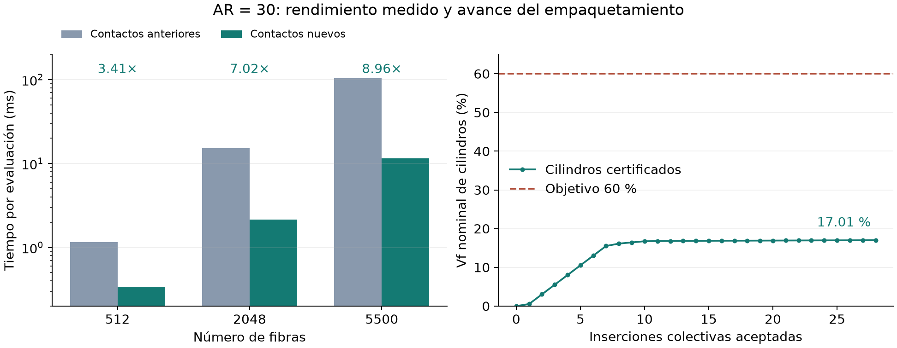

# Mejoras de SAM para cilindros rectos e isotropía, 2 de octubre de 2026

## Cierre de funcionamiento y velocidad

Por indicación del usuario se detuvieron los ensayos dirigidos a Vf = 60 %.
Se conservan sus checkpoints y resultados históricos. La validación final
comprueba el funcionamiento y el tiempo de una generación completa.

- Se corrigió la inercia rotacional de `SAMLiteGenerator`.
- En una relajación incompleta se conserva el estado de menor energía para
  continuar, evitando perder el avance entre bloques del optimizador.
- Tras una parada numérica temprana, solo se continúa si un paso de descenso
  reduce realmente la energía y queda presupuesto. El paso alternativo de
  traslación conserva las orientaciones. Una parada sin descenso termina el
  intento, sin reanudar indefinidamente.
- Los controles opcionales de inserción aleatoria y reducción de una fibra
  se validan y heredan al reanudar; el modo flexible rechaza esas opciones.
- La batería final aprobó **100 pruebas y 7 subpruebas**.

La comprobación completa en `benchmarks/results/sam_final_smoke_20261002`
usó cilindros rectos, AR = 30, Vf objetivo = 5 %, cubo de lado 60, separación
mínima 0,001 y grid 192³. Conservó los valores predeterminados de A4,
L-BFGS, selección de 128 candidatas y lotes adaptativos. Alcanzó las 458
fibras, pasó ambas auditorías periódicas y las comprobaciones voxelizadas,
y exportó `geometry.npz` con `accepted=True` y código de salida `0`.
El volumen voxelizado fue **4,9960 %**, con errores relativos voxelizados
A2 = 0,0584 % y A4 = 0,0789 %. El tiempo medido desde el comienzo de la
generación hasta la exportación fue **1,62 s**, con la compilación de Numba
ya disponible y un hilo de Numba/BLAS. Esa medición corresponde a este caso.
El resultado autoritativo está en su `summary.json`.

## Resultados anteriores

La implementación reduce el coste de los contactos y resuelve una inserción de
AR = 30 que el optimizador anterior no resolvía con 5.000 iteraciones. También
añade volumen y voxelización de cilindros planos, auditoría con memoria acotada,
lotes adaptativos y reanudación reproducible. **Vf = 60 % todavía no está
demostrado**. El ensayo denso conservó una geometría válida de 1.559 cilindros,
equivalente a 17,006 % nominal, en una caja de lado 60 diámetros.

La ruta mejorada se ejecuta con `cufhom-generate`, equivalente a
`python -m cufhom.cli.geometry`. La implementación histórica de
`SAMLiteGenerator`, usada por otras partes de la aplicación, conserva su
control A2 y ahora corrige su escala de inercia rotacional. La
[comprobación de viabilidad](FEASIBILITY.md) distingue capacidad del cubo e
isotropía simultánea y documenta esa corrección. La
[revisión inicial](../sam_review_20261002/REVIEW.md) explica
las diferencias con el artículo de [Schneider (2017)](https://doi.org/10.1007/s00466-016-1350-7).



- El núcleo de distancias usa temporales escalares. Conserva las imágenes
  periódicas, los contactos con copias de la misma fibra, los gradientes y las
  excepciones de segmentos conectados del generador flexible.
- El modo A4 admite L-BFGS con coordenadas de orientación normalizadas y escala
  inicial de inercia. Es el valor predeterminado del CLI para fibras rectas.
  `--optimizer gradient` permite usar el método anterior. Este L-BFGS no es un
  método Riemanniano con transporte de vectores.
- La auditoría independiente recorre todos los pares posibles en bloques de
  65.536. Un límite geométrico conservador descarta pares imposibles y se
  comprueban todas las imágenes restantes. No utiliza la lista de vecinos del
  optimizador. Las pruebas comparan su resultado completo con la versión
  exhaustiva, incluidos los empates del peor contacto.
- `--shape cylinder` usa volumen de cilindros y extremos planos en la
  voxelización. Los contactos siguen usando cápsulas, un criterio conservador
  para esos cilindros. A AR = 30, las cápsulas tienen 2,222 % más volumen por
  fibra. Confundir las convenciones altera el objetivo de Vf.
- Los lotes se reducen tras un rechazo y pueden crecer tras inserciones
  rápidas. Una relajación que mejora durante su bloque completo puede recibir
  más iteraciones, hasta `--max-relax-iterations`. Cada ampliación reinicia la
  memoria de L-BFGS desde el candidato obtenido; no vuelve a muestrear fibras.
- Los checkpoints conservan geometría certificada, orientación objetivo,
  dimensiones, forma física, estado aleatorio y programación de inserciones.
  La reanudación después de una pausa durante una relajación repite esa prueba
  desde su inicio. Un intento fallido ya terminado consume sus números
  aleatorios y conserva la reducción de lote correspondiente.
- Los reintentos pueden perturbar colectivamente la geometría de prueba. El
  CLI usa `--retry-shake .05`: desplazamientos con desviación estándar de
  0,05 diámetros y componentes de rotación de `0,1/AR` radianes. `0` lo
  desactiva. La primera prueba conserva la propuesta original; las siguientes
  usan esa perturbación y deben pasar las mismas auditorías.
- La selección inicial del CLI A4 evalúa 128 candidatas por fibra. Los ensayos
  iniciales de densificación usaban ocho; una comparación adicional consiguió
  una inserción válida usando 128 propuestas isotrópicas. El parámetro explícito
  `--candidates` tiene prioridad y se hereda al reanudar.

La aceptación exige auditorías de contactos y separación mínima, A2 y A4.
La longitud y el diámetro permanecen fijos durante cada relajación. Para
exportar `geometry.npz`, también deben pasar el objetivo de volumen y los
momentos voxelizados. Un resultado parcial devuelve código `2`.

`validation.json` contiene entradas identificadas por hash, fuentes, tiempos
y errores. La medición usa un hilo de Numba y un hilo de BLAS; excluye la
compilación inicial y toma la mediana de cinco evaluaciones. Los casos de
contactos son configuraciones sintéticas con intersecciones, no empaquetamientos
certificados.

| Fibras, AR = 30 | Objetivo con contactos anterior | Objetivo con contactos nuevo | Aceleración |
| ---: | ---: | ---: | ---: |
| 512 | 1,152 ms | 0,338 ms | 3,41× |
| 2.048 | 15,159 ms | 2,160 ms | 7,02× |
| 5.500 | 103,744 ms | 11,577 ms | 8,96× |

Ambas versiones usan exactamente los mismos vecinos. La diferencia máxima
de energía fue 3,64e-12 y la de gradientes 1,91e-9. El cambio de orden de las
operaciones de punto flotante afecta más a fuerzas cerca de ejes que casi se
intersectan; las pruebas también verifican gradientes mediante diferencias
finitas. La penetración máxima coincide dentro de 1,12e-15.

En 5.500 fibras, la auditoría tardó 2,41 s y su pico de asignaciones rastreadas
fue de 11,72 MiB. Esa cifra corresponde a `tracemalloc`, no al RSS completo del
proceso. La versión anterior reservaba todos los pares simultáneamente: solo
sus arrays principales representaban aproximadamente 1,69 GiB para ese tamaño.

La entrada `trial_ar30_vf15.npz` tiene 1.344 fibras, AR = 30, diámetro 1 y
caja de lado 60. Se aplican los mismos objetivos A2/A4, peso 1 y tolerancia de
contacto 1e-6, sin separación adicional:

| Optimizador | Iteraciones | Evaluaciones | Tiempo | Penetración máxima/d | Resultado |
| --- | ---: | ---: | ---: | ---: | --- |
| Gradiente anterior | 5.000 | 7.817 | 9,084 s | 0,003111 | Rechazado |
| L-BFGS nuevo | 216 | 218 | 1,014 s | 6,89e-7 | Contactos, A2 y A4 aceptados |

Estos dos tiempos ya incluyen el núcleo de contactos acelerado. La auditoría
se repitió sobre los resultados y quedó guardada en el JSON. Este caso valida
la mejora de relajación, pero no prueba capacidad para alcanzar 60 %.

El caso `benchmarks/results/sam_cylinder_ar30_vf05_20261002` alcanzó 458 fibras
con separación mínima 0,001, orientación isotrópica y grid 192³. Obtuvo
Vf voxelizado = 4,9987 %, error A2 voxelizado = 0,0386 % y error A4 voxelizado
= 0,0538 %. Pasó todas las comprobaciones y exportó `geometry.npz`. Su tiempo
total fue 2,18 s en ese entorno, con las compilaciones de contactos ya disponibles.

El primer intento de 60 % terminó con 1.550 de las 5.500 fibras objetivo en
488,59 s. Conservó 16,9079 % nominal de cilindros y ambas auditorías de
contactos/separación válidas. La continuación, con presupuesto de 300 s y
hasta 500.000 iteraciones por prueba, conservó 1.552 fibras y 16,9297 % nominal.
En ambos resultados `accepted=False`: el objetivo de 60 % está incompleto.
Se usó `--geometry-only`, por lo que esos porcentajes densos son nominales y
no están certificados por voxelización.

Los archivos autoritativos son:

- `benchmarks/results/sam_dense_cylinder_ar30_60_20261002/summary.json`.
- `benchmarks/results/sam_dense_cylinder_ar30_resume_20261002/summary.json`.
- `benchmarks/results/sam_dense_cylinder_ar30_candidates128_20261002/summary.json`.
- Sus checkpoints `last_geometrically_valid.npz` y registros `events.jsonl`.

La continuación permite bloques largos porque la mejora se juzga a lo largo
del bloque completo. Su inserción pendiente llegó aproximadamente a 147.000
iteraciones y seguía incumpliendo la separación mínima. Esto identifica una
limitación de reorganización colectiva, además del coste por evaluación.

El ensayo general de perturbaciones, con ocho candidatas y cinco intentos,
no aumentó el conteo de 1.552. Después, la selección de 128 candidatas con
perturbaciones pequeñas avanzó hasta 1.559 cilindros en 300,79 s. El porcentaje
nominal fue 17,0061 %, el error A2 continuo 1,07e-8 y el error A4 2,17e-8.
Ambas auditorías geométricas pasaron. La inserción de 1.560 se interrumpió al
agotar el presupuesto. Ese checkpoint constituye el avance denso más reciente;
el objetivo de 5.500 fibras permanece incompleto.

Una prueba de 20.000 iteraciones sobre `trial_ar30_1553.npz` conservó radios de
coordenadas de orientación entre 8,857 y 8,878. No mostró una pérdida grande
de movilidad causada por el crecimiento de esas coordenadas. Los resultados
están en `orientation_metric_probe.json`.

Reducir el peso de A4 a 0,01 o 0,1 no produjo una solución aceptada tras
20.000 iteraciones: fallaron contactos y A4. Una penalización con banda libre
de A4 = 5e-5 tampoco eliminó contactos tras 50.000 iteraciones. Esa variante
experimental no se incorporó al generador. Los resultados negativos se
conservan en `orientation_weight_probe.json` y `a4_deadzone_probe.json`.

Una perturbación colectiva de 0,05 diámetros permitió resolver ese mismo
candidato de 1.553 fibras en 8.790 iteraciones y 16,38 s, con error A4
2,27e-8 y violación relativa de separación máxima 9,93e-7. Perturbaciones
de 0,2 y 0,5 diámetros no pasaron todas las comprobaciones. La pequeña se
incorporó a los reintentos del CLI. `shake_probe.json` contiene esos tres
resultados; la prueba positiva queda en `shake_0.05_1553.npz`. Esto demuestra
que puede superar una configuración atascada, sin demostrar aún 60 %.

La comparación `bundle_proposal_probe.json` usó 128 candidatas por fibra desde
el checkpoint de 1.552 fibras. La propuesta isotrópica pasó contactos, separación
y A4 en 9.539 iteraciones y 16,34 s. La propuesta local paralela probada no pasó
la separación tras 20.000 iteraciones, por lo que ese sesgo de orientación no
se incorporó al generador. El resultado isotrópico aceptado está en
`proposal_isotropic_1553_valid.npz`.

Los ensayos históricos no demostraron alcanzar el porcentaje denso del
artículo. El artículo usa presupuestos mucho mayores y presenta haces locales
alineados dentro de una distribución global isotrópica. La campaña se cerró
por indicación del usuario.

```bash
OPENBLAS_NUM_THREADS=1 OMP_NUM_THREADS=1 .venv/bin/python \
  benchmarks/sam_improvements_20261002/validate_improvements.py \
  --output /tmp/sam_validation_repeated.json

PYTEST_DISABLE_PLUGIN_AUTOLOAD=1 OPENBLAS_NUM_THREADS=1 OMP_NUM_THREADS=1 \
  .venv/bin/python -m pytest -q tests/test_sam*.py

.venv/bin/python -m cufhom.cli.geometry \
  --output runs/ar30_vf60_01 --shape cylinder --vf .60 --ar 30 --box 60 \
  --min-gap .001 --initial-count 48 --batch-size 229 --candidates 8 \
  --relax-iterations 2000 --max-relax-iterations 32000 \
  --seed 20261002 --threads 1 --geometry-only --wall-seconds 600

.venv/bin/python -m cufhom.cli.geometry \
  --output runs/ar30_vf60_02 \
  --resume runs/ar30_vf60_01/last_geometrically_valid.npz \
  --max-relax-iterations 500000 --geometry-only --wall-seconds 300

.venv/bin/python -m cufhom.cli.geometry \
  --output runs/ar30_vf60_03 \
  --resume runs/ar30_vf60_02/last_geometrically_valid.npz \
  --candidates 128 --retry-shake .05 --max-relax-iterations 32000 \
  --geometry-only --wall-seconds 300
```

Los directorios de salida deben ser nuevos. El primer ensayo documentado
precede al ajuste para ampliar según todo el bloque; sus resultados históricos
se conservan. La continuación usa ese ajuste. Conservar un checkpoint permite
retomar trabajo válido, pero el tiempo usado por una prueba interrumpida no se
recupera: esa prueba se vuelve a ejecutar.

La validación de geometría, orientación, gradientes, reanudación y modos
recto/flexible terminó con **88 pruebas y 7 subpruebas aprobadas**. El resultado
está en `tests.txt`. La figura se regenera con `plot_results.py`; sus porcentajes
corresponden a commits certificados y siguen siendo volúmenes nominales.

La revisión posterior de viabilidad y la corrección de inercia de la ruta
histórica añadieron seis pruebas. La batería completa pasó **94 pruebas y
7 subpruebas**; el registro está en `tests_feasibility.txt`.
