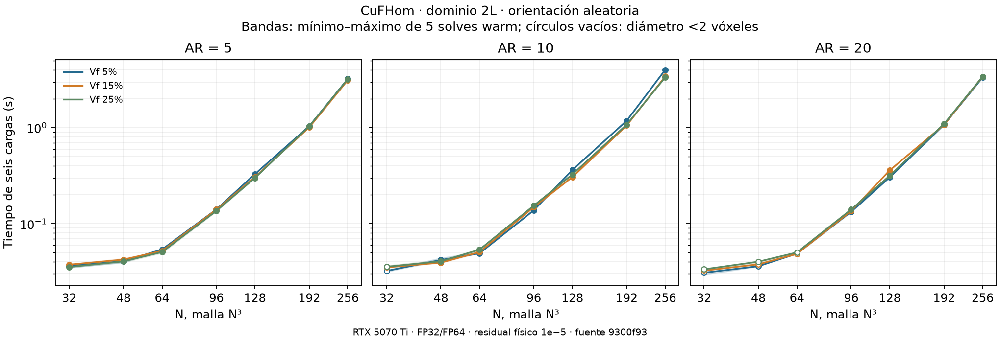
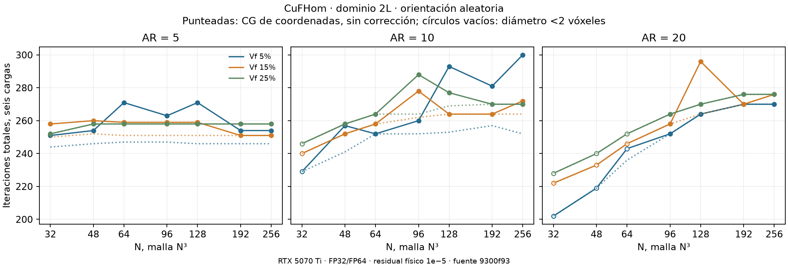
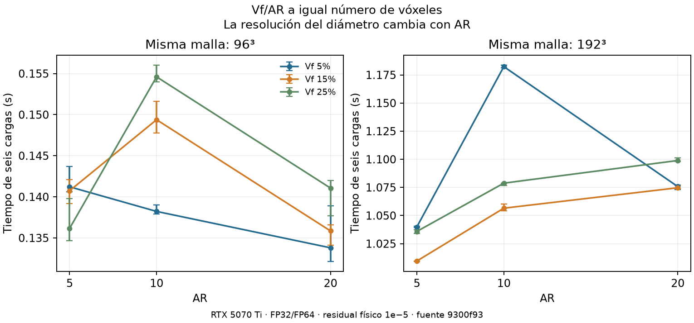
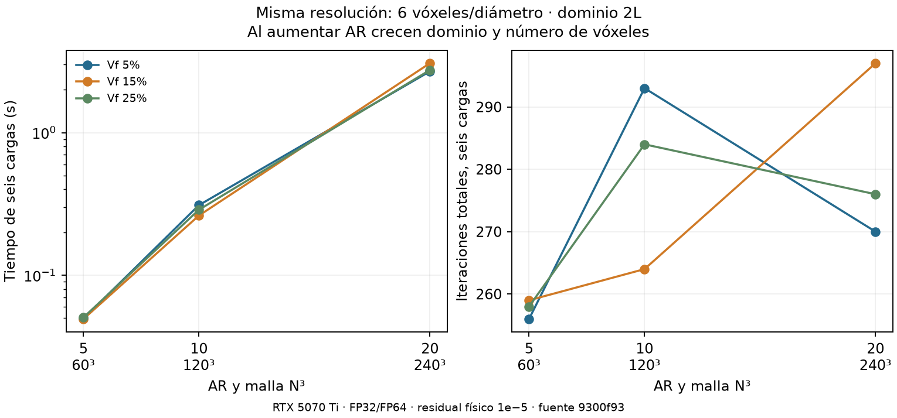

# CuFHom: curvas de Vf, AR y vóxeles

**72 puntos, cinco repeticiones por punto, nueve microestructuras continuas.** Las curvas usan los defaults de 9300f9302064, antes de los pilotos de esta revisión. Las comparaciones de candidatos se miden aparte y sus ahorros no se suman a las curvas.

## Condiciones

- Vf objetivo 5, 15 y 25%; AR 5, 10 y 20; orientación aleatoria; d = 1 µm.
- L = AR × d es la longitud axial de la cápsula. Su longitud total incluye las tapas. Dominio cúbico de lado 2L.
- El mismo master se voxeliza en 32³, 48³, 64³, 96³, 128³, 192³ y 256³. A 6 vóxeles por diámetro se usan además 60³, 120³ y 240³.
- RTX 5070 Ti; CuPy 13.6.0, runtime CUDA 12.9, cuFFT 11.4.1. Seis cargas lineales; campos/FFT FP32, productos FP64, residual físico ≤1e-5 y Ceff SPD.
- Un calentamiento por punto y cinco solves medidos: 360 muestras y 72 calentamientos, 2.592 cargas.
- La pared incluye setup del material, solve, auditorías, posprocesado y JSON. Lectura/agrupación de geometría y hashes se hacen antes y se informan aparte.
- Un master por Vf/AR: la dispersión temporal no mide variabilidad entre realizaciones. El escritorio comparte GPU; no se fijan relojes.

## Curvas

Los círculos vacíos tienen menos de dos vóxeles por diámetro. Son tiempos de una entrada discreta; no prueban fidelidad geométrica ni convergencia de homogenización. Bandas: mínimo/máximo de cinco repeticiones, no intervalos de confianza. Las líneas unen mediciones sin ajustar una ley universal.

### Vf/AR a igual número de vóxeles

| Vf % | AR | 96³ s | CG / corrección | 192³ s | CG / corrección | 256³ s | CG / corrección |
| ---: | ---: | ---: | ---: | ---: | ---: | ---: | ---: |
| 5 | 5 | 0.141219 | 263 / 16 | 1.039913 | 254 / 8 | 3.221898 | 254 / 8 |
| 5 | 10 | 0.138225 | 260 / 8 | 1.182363 | 281 / 24 | 4.006399 | 300 / 48 |
| 5 | 20 | 0.133796 | 252 / 0 | 1.075739 | 270 / 0 | 3.341146 | 270 / 0 |
| 15 | 5 | 0.140744 | 259 / 8 | 1.009581 | 251 / 0 | 3.129640 | 251 / 0 |
| 15 | 10 | 0.149384 | 278 / 16 | 1.056535 | 264 / 0 | 3.419689 | 272 / 8 |
| 15 | 20 | 0.135852 | 258 / 0 | 1.074692 | 270 / 0 | 3.409043 | 276 / 0 |
| 25 | 5 | 0.136167 | 258 / 0 | 1.035884 | 258 / 0 | 3.210876 | 258 / 0 |
| 25 | 10 | 0.154602 | 288 / 24 | 1.078785 | 270 / 0 | 3.345081 | 270 / 0 |
| 25 | 20 | 0.141065 | 264 / 0 | 1.098914 | 276 / 0 | 3.408081 | 276 / 0 |

### A igual resolución física

| Vf % | AR 5, 60³ s | AR 10, 120³ s | AR 20, 240³ s |
| ---: | ---: | ---: | ---: |
| 5 | 0.049465 | 0.309653 | 2.689745 |
| 15 | 0.049207 | 0.261802 | 3.068226 |
| 25 | 0.050450 | 0.287483 | 2.747720 |

A igual resolución y dominio 2L, pasar de AR 5 a 20 multiplica el volumen discreto por 64. El gráfico incluye ese cambio de tamaño; no aísla el efecto de la forma.

## Qué explican las mediciones

Vf y AR no ordenan las iteraciones de manera monótona. Vf 5%, AR 10 necesita 293 CG en 128³ y 281 en 192³, pero tarda más en 192³ porque cada aplicación recorre más datos. Ese caso suma 48 CG de corrección en 256³. Vf 25%, AR 10 necesita 288 CG en 96³ y 270 en 192³. Una malla pequeña puede necesitar más iteraciones sin consumir más tiempo total.

Las iteraciones dependen del espectro, de los modos excitados por los RHS, del contraste/anisotropía y del redondeo. La memoria y el plan FFT afectan sobre todo al coste de cada aplicación. El barrido no mide autovalores ni identifica una causa única de cada diferencia. La corrección aparece cuando el criterio de coordenadas no basta para el residual físico. Los cambios de norma/precisión ya ensayados siguen [descartados](../../descartados/performance_audit_20261001/README.md).

La elección FFT cambia con N:

| N | Política aprendida | Tuning inicial s |
| ---: | --- | ---: |
| 32 | full | 0.021379 |
| 48 | full | 0.006277 |
| 60 | full | 0.007092 |
| 64 | full | 0.006958 |
| 96 | full | 0.012105 |
| 120 | batch3 | 0.019033 |
| 128 | batch2 | 0.022741 |
| 192 | component | 0.101385 |
| 240 | component | 0.210245 |
| 256 | component | 0.259686 |

El tuning se hace una vez por configuración y queda fuera de las medianas warm. Estas cifras no son tiempos de arranque desde un proceso frío. [Muestras](samples.csv), [72 puntos y metadatos](curves.csv), [planes](fft_plans.csv).

## Revisión del código: dos pilotos nuevos

1. Reutilizar Fσ de la comprobación verdadera en la misma proyección física elimina seis R2C por carga reutilizada: 36 transformadas de componentes en las seis cargas. Conserva escala, cero/Nyquist y residual verdadero.
2. Crot = B(R) C B(R)ᵀ en Mandel sustituye cuatro contracciones de un tensor de cuarto orden y 21/36 lanzamientos de empaquetado por un kernel. La rotación usa FP64 y redondea una vez al dtype solicitado. Admite anisotropía general y no usa una fórmula exclusiva de fibras.

| Caso | Referencia s | Ambos pilotos s | Ahorro medianas % | Pares favorables / 5 | CG, ambos |
| --- | ---: | ---: | ---: | ---: | ---: |
| G08 | 0.051900 | 0.049964 | 3.73 | 5 | 256 |
| G09 | 2.746717 | 2.731032 | 0.57 | 5 | 276 |
| F192 | 1.054355 | 1.050741 | 0.34 | 3 | 264 |
| N64 | 0.035295 | 0.034727 | 1.61 | 4 | 148 |
| N256 | 1.801395 | 1.781443 | 1.11 | 5 | 132 |
| R128 | 0.202681 | 0.200821 | 0.92 | 5 | 162 |

La ganancia total es pequeña y algunos casos quedan dentro de la dispersión; no disminuyen las iteraciones. La rotación ahorra aproximadamente 0,8 ms de setup en los casos pequeños. Ese reloj mide la llamada host con encolado CUDA, no tiempo exclusivo GPU. [Ablación y extremos pareados](candidates.csv).

Los seis campos completos se comparan en G08, G09, F192, N64, N256 y R128; 8³ también contra CPU64 a residual 1e-10. Ceff es SPD y los residuales físicos GPU son ≤1e-5. La rotación se compara con el tensor de cuarto orden CPU64 para una matriz SPD anisótropa, 31 orientaciones, tabla completa/sym21 y FP32/FP64. [Errores y hashes](fields.csv).

## Implementación final integrada

Cinco pares alternados con el mismo código final: defaults frente al constructor de material exacto de 9300f93 y reutilización del espectro desactivada. La rotación anterior se conserva solo en el runner de control.

| Caso | Antes s | Defaults finales s | Ahorro medianas % | Pares favorables / 5 | CG, ambos |
| --- | ---: | ---: | ---: | ---: | ---: |
| G08 | 0.050167 | 0.050173 | -0.01 | 1 | 256 |
| G09 | 2.746078 | 2.730610 | 0.56 | 5 | 276 |
| F192 | 1.054147 | 1.051225 | 0.28 | 5 | 264 |
| N64 | 0.035716 | 0.034893 | 2.30 | 4 | 148 |
| N256 | 1.798734 | 1.780802 | 1.00 | 5 | 132 |
| R128 | 0.203266 | 0.202248 | 0.50 | 3 | 162 |

**357 pruebas y 7 subpruebas de producción pasan.** G09, F192 y N256 mejoran en los cinco pares. G08 no muestra una mejora total estable; N64/R128 tienen dispersión. Se conservan ecuación, cargas y aceptación física. Las diferencias de campos por rotación se informan sin afirmar igualdad bit a bit. [Tiempos finales](production.csv), [campos finales](production_fields.csv).

La decisión de producción y las prioridades de la revisión están en [CODE_REVIEW.md](CODE_REVIEW.md).

## Reproducción

[evidence.json.gz](evidence.json.gz) conserva JSON, fuentes exactas, hashes, nueve masters continuos y pruebas. Las voxelizaciones grandes siguen en el directorio local de geometrías. El informe se reconstruye sin GPU:

    .venv/bin/python benchmarks/vf_ar_curves_20261002/build_report.py --evidence benchmarks/vf_ar_curves_20261002/evidence.json.gz --output /tmp/cufhom_curves_rebuilt

Nueva campaña GPU secuencial:

    bash benchmarks/vf_ar_curves_20261002/run_gpu.sh benchmarks/vf_ar_curves_20261002/run_curves.py --output benchmarks/results/vf_ar_new

Los masters conservan la auditoría periódica y la tolerancia histórica de contacto de 1/120. Cada punto informa Vf voxelizada y A₂; no se sustituyen por los objetivos.
